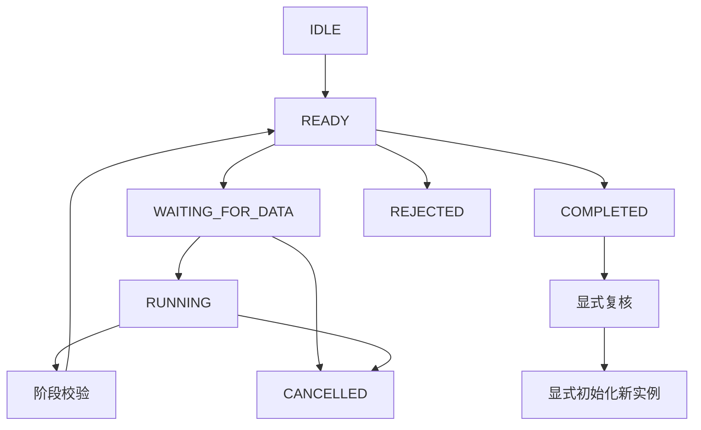

# FalconFOC 统一标定工作流

`falconfoc-calibration-workflow` 是可选的 C11 冷路径目标。它编排既有估计器并保留原生质量结果。应用方提供测量及前提，持有工作流及样本，序列化所有调用。可选 `falconfoc-calibration-application` 负责与 Control Plane、Config Inspector 和新 Host Runtime 衔接。

[工作流公开头](include/foc_calibration_workflow.h) · [应用公开头](../control_plane/include/foc_calibration_application.h) · [独立 Host 运行示例](../examples/calibration-workflow/README.md)

## 能力与获取边界

| 阶段 | 已有 API | 必需观测及身份 | 候选和质量 |
| --- | --- | --- | --- |
| ADC 零偏 | `foc_calibration_adc_*` | 同一 ADC 满量程、增益和相序的三相原始计数，独立确认无电流。 | 三相偏置和计数 RMS，沿用数量、相邻变化和噪声约束。 |
| 电气 R/L | `foc_motor_id_*` | 同一电机、固定 d 或 q 轴、对齐的相电流和实际区间平均电压，静止、限幅和输出确认。 | 单轴 Rs Ω 和 L H，残差与激励度。 |
| Rotor | `foc_calibration_rotor_*` | 已注明坐标、采样时刻的机械与独立电角参考，足以区分极对数和相对方向。 | 方向、极对数、候选间距和残差。 |
| 电角零点 | `foc_calibration_offset_*` | 独立采集身份、已验收 Rotor、同一编码器机械映射的电角对齐参考。 | 电角零点 rad 及圆周残差。 |
| Encoder LUT | `foc_encoder_cal_*` | 原始码与独立机械参考同步，给出 CPR、编码器与参考身份、正向和机械零点。独立采集用于 Holdout。 | 周期补偿表，训练及独立 Holdout 覆盖、残差和生产 Encoder 准入。 |
| 机械 J/B | `foc_mechanical_id_*` | 同时刻速度与可用实际转矩，独立确认负载可忽略或测得负载。转矩与速度间隔须合格，采集未饱和。 | J kg·m²、B N·m·s/rad、拟合残差、激励度和条件指标。 |
| Servo K/D | `foc_impedance_tuning_design` | 可信 J/B 和独立合格 Kt，以及经应用声明的动力学、周期、延迟和增益边界。 | K N·m/rad 和 D N·m·s/rad 候选及理想设计参数。 |

Host 支持明确标记的合成样本、虚拟测量和外部记录。来源映射到既有 Motor-ID 与 Encoder API 时用其两类来源，工作流保留原始三类标签。Workflow 本身没有采集或激励入口。合成参考的几何、电压、电流及负载在示例数据生成端形成。示例没有物理 Kt、磁链或扭矩传感器。Host 的模拟前提不能代替实机测量与安全许可。

## 会话与阶段

`FULL_PROFILE` 要求全部七个子阶段。`SELECTED_STAGES` 只要求所选阶段及明确的依赖。J/B 可单独执行。K/D 依赖本会话合格 J/B 和有单独来源、采集标识和采样时刻的可信 Kt。Kt 未提供时返回 `DATA_REQUIRED`，可在同一会话补齐该依赖。Offset 依赖本会话 Rotor。包含 LUT 的 Rotor 还须等待该 LUT 的独立 Holdout 通过。

带 LUT 的 Rotor 和 Offset 接收原始码与电角参考，使用冻结 LUT 和生产 Encoder 对采集机械角解码，传入的浮点机械角被替换。原始码方向先按采集设置处理，Rotor 拟合给出相对方向，正式 Calibration Admission 再组合成 Runtime Encoder 方向。获准应用的 LUT、目标 Runtime 机械坐标和已认可的 Encoder 方向须相符。机械方向改变时需要独立的坐标重审，应用入口会拒绝沿用旧保护坐标直接切换。

每个调用方先零初始化上下文再调用 `init`。工作流 Session 按 UInt32 半程规则前进，独立于 Runtime Motion Session。每个阶段的 Capture ID 在该会话唯一，LUT Holdout 和可信 Kt 也使用独立 ID。样本按原始序列和统一采样时钟校验，重复、倒序、超出采样年龄、类型或单位不符的观测不会被替换成默认值。传统原生估计器继续负责各自的范围、误差和激励约束。外层身份变化撤销会话候选。其他失败保留独立合格阶段用于诊断。取消或新会话启动使旧候选失效。

## 审查、应用与存储

1. 从 `foc_cal_workflow_result()` 读取阶段状态、原生失败、采集时间和质量。所有请求阶段通过表示 `complete`。ADC/方向/电角零点通过正式 Calibration Admission 后才具备 `applicable`。调用方进行一次同 Session、同身份的显式 review，才能准备应用。
2. 使用 `foc_cal_application_start()` 绑定旧 Runtime 的已确认 INHIBIT、无故障和 DISABLED 快照，同时开始工作流。已经存在的生命周期请求、STOP、Fault、输出确认丢失和过期绑定都会阻止后续应用。应用期间保证原实例及事件入口静止。绑定期间禁止原地重新初始化。带可执行的 Host 抢占回调的实例不能作为该路径的只读观察对象。
3. `foc_cal_application_prepare()` 生成分离的 Pipeline、Encoder 和 Runtime 候选。它复用 Control Plane 校验及 SOFT-03 的现有兼容性检查。通用 Inspector 只显示稳定参数 ID。ADC 偏置与 LUT 通过应用层候选和新实例 Encoder 读回。只有 ADC 或 LUT 变化时，通用 Inspector 的值相符依然需要应用方按正式入口重初始化。
4. `foc_cal_application_apply()` 复核旧快照、当前工作流和已签收的身份，在独立、清零的存储上显式初始化 Host Runtime/Encoder。新实例沿用原 Pipeline 的控制与保护政策，以关闭输出回调的 Host Mock 初始化。Encoder LUT 复制到调用方新 Sensor 存储，调用方保持该地址和内容稳定。读取新旧实例分辨 `CANDIDATE_ACCEPTED` 和 `CONFIGURATION_APPLIED`。
5. SOFT-03 Schema 2 继续只能存现有运动保护及限制。极对数、电角零点和 Kt 用于现有记录的适用身份。校准后的这些身份字段改变时，旧策略的 Store 检查可能报身份不匹配，属于预期独立结果。ADC 偏置、Encoder LUT、Rs/L、J/B、K/D 推荐和采集质量需要单独审核的新配置版本。Workflow 和应用适配器均没有写入动作。

新 Runtime 初始化保留 SOFT-02 配置。静态 K/D 上限不由整定结果更改，推荐值留给调用方评估。新实例以软件 INHIBIT 启动，运行仍需现有许可。参见 [验收和证据](../docs/evidence/2026-11-19-next-soft-05.md)。
