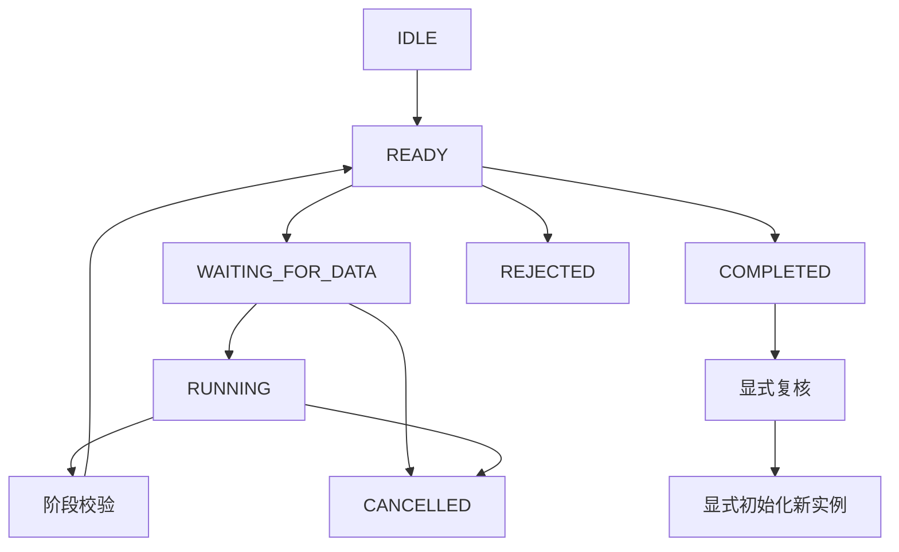

# FalconFOC 统一标定工作流

`falconfoc-calibration-workflow` 是可选的 C11 冷路径目标。它编排既有估计器并保留原生质量结果。应用方提供测量及前提，持有工作流及样本，序列化所有调用。可选 `falconfoc-calibration-application` 负责与 Control Plane、Config Inspector 和新 Host Runtime 衔接。

[工作流公开头](include/foc_calibration_workflow.h) · [应用公开头](../control_plane/include/foc_calibration_application.h) · [独立 Host 运行示例](../examples/calibration-workflow/README.md)

## Host 执行入口

使用 [falconfoc-cli calibrate](../tools/falconfoc-cli/README.md#host-motor-calibration-and-foc) 启动独占虚拟采集。Foreground 每次推进一个有界阶段。采集器将实际虚拟 ADC、Encoder、端电压和独立虚拟仪器读数交给工作流。方向、机械与电角参考来自分别声明的采集通道。电气 d/q 阶段使用真实约束转子的独立窗口。Rs 一致性检查通过后合并两轴用于 PI 设计。磁链由正反转的端电压与电角速度辨识，Ke 和 Kt 按声明峰值约定派生。机械拟合使用独立的等效轴转矩与有符号负载观测。

旧调用可继续提交单轴。新 Host 请求用 `require_dual_axis` 将电气阶段的通过条件扩充到两个独立 Capture 及合格的 Rs/Ld/Lq 模型。第一轴成功时返回 `PARTIAL`，仅第二轴及联合模型通过后标记阶段合格。线上协议和历史 Measurement Trace v1 的单轴数据及阶段编号沿用原契约。

审核后的数据通过 `foc_cal_application_prepare_tuned()` 验证 PI 带宽、采样和更新延迟、电压与电流余量，并按 J/B、Kt 生成外环候选。应用时复算审核过的参数，通过初始化期的显式 Host 适配器绑定新实例。K/D 经正式 Impedance 指令消费。可选齿槽表在 H1 使用独立采集、Holdout 和身份检查，沿用 Motion 和 Safety 准入。FCAL v1 保存和重载属于 Host 工作流。

## 能力与获取边界

| 阶段 | 已有 API | 必需观测及身份 | 候选和质量 |
| --- | --- | --- | --- |
| ADC 零偏 | `foc_calibration_adc_*` | 同一 ADC 满量程、增益和相序的三相原始计数，独立确认无电流。 | 三相偏置和计数 RMS，沿用数量、相邻变化和噪声约束。 |
| 电气 R/L | `foc_motor_id_*` | 同一电机、固定 d 或 q 轴、对齐的相电流和实际区间平均电压，静止、限幅和输出确认。 | 单轴 Rs Ω 和 L H，残差与激励度。 |
| Rotor | `foc_calibration_rotor_*` | 已注明坐标、采样时刻的机械与独立电角参考，足以区分极对数和相对方向。 | 方向、极对数、候选间距和残差。 |
| 电角零点 | `foc_calibration_offset_*` | 独立采集身份、已验收 Rotor、同一编码器机械映射的电角对齐参考。 | 电角零点 rad 及圆周残差。 |
| Encoder LUT | `foc_encoder_cal_*` | 原始码与独立机械参考同步，给出 CPR、编码器与参考身份、正向和机械零点。独立采集用于 Holdout。 | 周期补偿表，训练及独立 Holdout 覆盖、残差和生产 Encoder 准入。 |
| 机械 J/B | `foc_mechanical_id_*` | 同时刻速度与可用实际转矩，独立确认负载可忽略或测得负载。转矩与速度间隔须合格，采集未饱和。 | J kg·m²、B N·m·s/rad、拟合残差、激励度和条件指标。 |
| Servo K/D | `foc_impedance_tuning_design` | 可信 J/B 和来源合格的 Kt，以及经应用声明的动力学、周期、延迟和增益边界。 | K N·m/rad 和 D N·m·s/rad 候选及理想设计参数。 |

Host 支持明确标记的合成样本、虚拟测量和外部记录。来源映射到既有 Motor-ID 与 Encoder API 时用其两类来源，工作流保留原始三类标签。Workflow 本身没有采集或激励入口。合成参考的几何、电压、电流及负载在示例数据生成端形成。示例没有物理 Kt、磁链或扭矩传感器。Host 的模拟前提不能代替实机测量与安全许可。

## 会话与阶段

`FULL_PROFILE` 要求全部七个子阶段。`SELECTED_STAGES` 只要求所选阶段及明确的依赖。J/B 可单独执行。K/D 依赖本会话合格 J/B 和有单独来源、采集标识和采样时刻的可信 Kt。Kt 未提供时返回 `DATA_REQUIRED`，可在同一会话补齐该依赖。Offset 依赖本会话 Rotor。包含 LUT 的 Rotor 还须等待该 LUT 的独立 Holdout 通过。

带 LUT 的 Rotor 和 Offset 接收原始码与电角参考，使用冻结 LUT 和生产 Encoder 对采集机械角解码，传入的浮点机械角被替换。原始码方向先按采集设置处理，Rotor 拟合给出相对方向，正式 Calibration Admission 再组合成 Runtime Encoder 方向。获准应用的 LUT、目标 Runtime 机械坐标和已认可的 Encoder 方向须相符。机械方向改变时需要独立的坐标重审，应用入口会拒绝沿用旧保护坐标直接切换。

每个调用方先零初始化上下文再调用 `init`。工作流 Session 按 UInt32 半程规则前进，独立于 Runtime Motion Session。每个阶段的 Capture ID 在该会话唯一，LUT Holdout 和可信 Kt 也使用独立 ID。样本按原始序列和统一采样时钟校验，重复、倒序、超出采样年龄、类型或单位不符的观测不会被替换成默认值。传统原生估计器继续负责各自的范围、误差和激励约束。外层身份变化撤销会话候选。其他失败保留独立合格阶段用于诊断。取消或新会话启动使旧候选失效。

## 审查、应用与存储

1. 从 `foc_cal_workflow_result()` 读取阶段状态、原生失败、采集时间和质量。所有请求阶段通过表示 `complete`，可以进行同 Session、同身份的显式审核。准备应用还要求 `applicable`，由 ADC、方向和电角零点通过正式 Calibration Admission 后置位。J/B-only 和 Rs-only 审核可以保留分项结论。
2. 使用 `foc_cal_application_start()` 绑定旧 Runtime 的已确认 INHIBIT、无故障和 DISABLED 快照，同时开始工作流。已经存在的生命周期请求、STOP、Fault、输出确认丢失和过期绑定都会阻止后续应用。应用期间保证原实例及事件入口静止。绑定期间禁止原地重新初始化。带可执行的 Host 抢占回调的实例不能作为该路径的只读观察对象。
3. `foc_cal_application_prepare()` 生成分离的 Pipeline、Encoder 和 Runtime 候选。它复用 Control Plane 校验及 SOFT-03 的现有兼容性检查。通用 Inspector 只显示稳定参数 ID。ADC 偏置与 LUT 通过应用层候选和新实例 Encoder 读回。只有 ADC 或 LUT 变化时，通用 Inspector 的值相符依然需要应用方按正式入口重初始化。
4. `foc_cal_application_apply()` 复核旧快照、当前工作流和已签收的身份，在独立、清零的存储上显式初始化 Host Runtime/Encoder。新实例沿用原 Pipeline 的控制与保护政策，以关闭输出回调的 Host Mock 初始化。Encoder LUT 复制到调用方新 Sensor 存储，调用方保持该地址和内容稳定。读取新旧实例分辨 `CANDIDATE_ACCEPTED` 和 `CONFIGURATION_APPLIED`。
5. SOFT-03 Schema 2 继续只能存现有运动保护及限制。极对数、电角零点和 Kt 用于现有记录的适用身份。校准后的这些身份字段改变时，旧策略的 Store 检查可能报身份不匹配，属于预期独立结果。ADC 偏置、Encoder LUT、Rs/L、J/B、K/D 推荐和采集质量需要单独审核的新配置版本。Workflow 和应用适配器均没有写入动作。

传统应用入口保留原 SOFT-02 控制参数。经审核的 Host 整定入口在新 Runtime 安装 d/q PI、速度和位置增益及 Kt，保留 K/D 静态上限；K/D 候选进入正式控制命令。新实例以软件 INHIBIT 启动，运行仍需现有许可。参见 [验收和证据](../docs/evidence/2026-11-19-next-soft-05.md)。

## Host 历史复用

Host 校准命令把已审核分项的会话、采集、来源、适用工况、设备身份与依赖版本保留在进程内。组合前按静态物理依赖求出需要重采集的阶段，复用部分仍保留原始记录。完整候选再次经过已有 Admission、增益复核和 Calibration Application。独立等效转矩的 J/B 可以在 Kt 更新后继续使用，Servo 整定会使用本次已审核的 Kt。使用 Kt×Iq 的 J/B 仍要求原转矩模型和尺度匹配。设备或来源超出虚拟台架支持范围时，复用流程返回具体原因并等待合格参考。

FCAL v1 继续保存数值配置并支持原审核路径。复用来源和依赖历史只在当前 Host 进程内有效。 [CLI 使用方式](../tools/falconfoc-cli/README.md#host-parameter-review-and-reuse) · [依赖表和验收](../docs/evidence/2026-11-20-next-cal-arch-02.md)

## 磁链与 Kt

Host 在完成合格 R/L 和极对数后将共时的端电压、d/q 电流和电角速度区间交给通用 `foc_flux_id`。七阶段编号保持。Flux/Kt 仍是进入整定前的单独采集记录，携带 R/L、极对数和电流链修订、磁轴和电压链身份及原会话。测得的磁链、推导的 Ke 和 Kt 保留同一来源关系。独立转矩是额外的来源类别，原有 J/B 及独立 Kt 的准入继续适用。

组合预览提供方向拟合、残差、速度范围和来源。应用前复核 Flux/Kt 证据指纹、已审核依赖修订与现有完整配置。独立角度见证下，编码器映射变化可保留 Flux。相序、磁轴、电机和 R/L 变化按 ARCH-02 规则失效。全量 FCAL v1 继续存数值，新的复用证据仍保留在当前 Host 进程。 [FLUX-01 报告](../docs/evidence/2026-11-20-next-cal-flux-01.md)

## 未知电机初始化

Host 先核对电机、装配、编码器、相序和 ADC 采样身份，再检查已观测的 ADC 零偏、母线电压、时钟和输出抑制。可信的 FCAL v1 可走已有审核路径，无需扫描。只缺 Offset 时用已声明的极对数和方向约束候选。三者均未知时从原始码、共时的有符号轴速与开路 αβ 端电压辨识候选。采样跨度、方向一致性、候选间隔、圆周残差和四段重复性均参与资格判定。

独立虚拟机械驱动使转轴实际运动，绕组开路，旧 Runtime 保持已确认的 INHIBIT。端电压相位按独立轴速的符号转换为磁轴参考。电压采样相序及符号来自已核对的接线约定。停转、反电势过弱、参考冲突或抑制确认丢失都会阻止继续。粗结果标记为 `COARSE_ELECTRICAL_REFERENCE`，只能为后续采集提供参考。

Encoder LUT 使用独立轴角训练和 Holdout 采集。后续 Rotor 与 Offset 使用新的端电压窗口、原始码和经 Holdout 验证的 LUT，再由有向整数计数生成 R/L 和 Flux 的 d/q 参考。J/B 使用独立等效转矩与负载读数。完整组合仍经过显式审核与原 Calibration Application。用此路径获得的 Ld/Lq 和 Flux/Kt 随所用 LUT 或 Offset 失效。独立角度见证的历史路径沿用原复用规则。

[CLI 用法](../tools/falconfoc-cli/README.md#host-commutation-bootstrap) · [初始化验收](../docs/evidence/2026-11-20-next-cal-boot-01.md)
