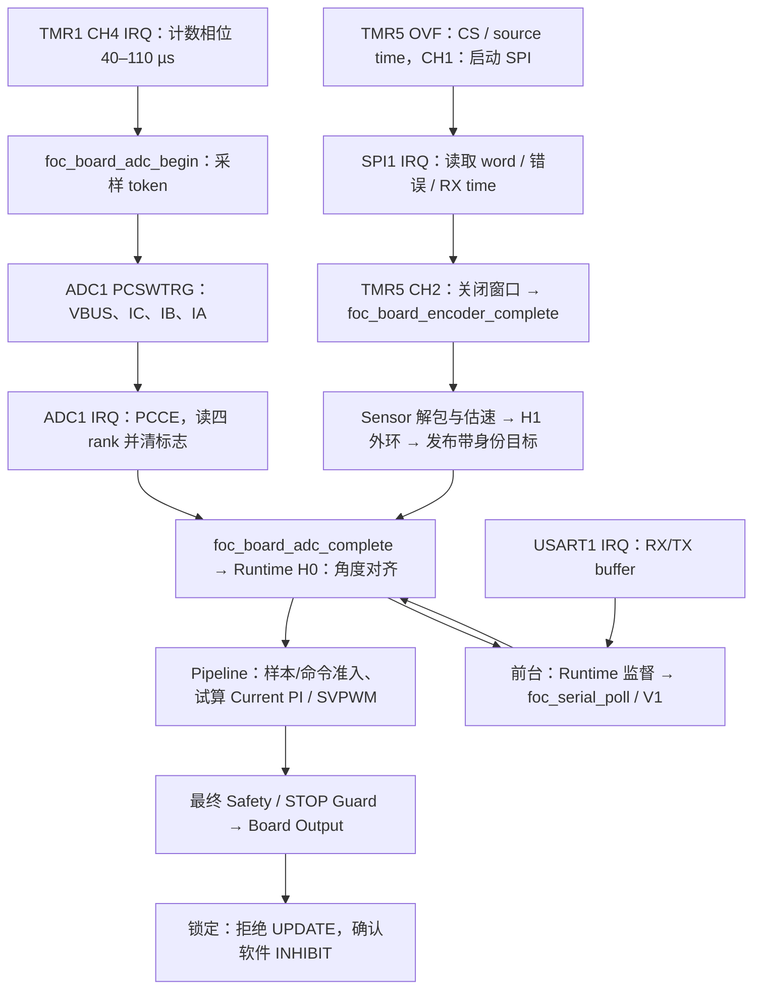

# ARCH-001｜FalconFOC V2 实时执行架构与变更规则

- **日期** 2026-11-19
- **状态** 架构变更规则生效。保留方案 B。ARCH-00 的 Host 合同和 RT-01 的 Board 采样交接已进行软件验证，目标板触发及性能参数待验收。
- **适用范围** FalconFOC V2 的 Core、Runtime 和 Reference Firmware 边界。Legacy 实测作为有独立出处的历史证据。 [项目纲领](FalconFOC_Project_Charter_and_Engineering_Memory_v1.0.md)

## 决定与证据

**FalconFOC 的架构必须由产品目标、成熟工程方法和可验证证据共同决定，不能随着每一次讨论的方向反复变化。**

产品目标确定应满足的接口、控制品质和安全约束。成熟工程提供可比较的实现和验收方法。可复现证据决定取舍及适用范围。评审应明确当前实现、已采纳的架构方向、候选参数和待证假设。新讨论可以提出验证任务，变更现役裁决走下方的 Architecture Change Gate。

| 决策层 | 当前裁决 |
| --- | --- |
| 产品架构 | 保留独立的纯 C11 Core，供第三方在自己的执行环境集成。Core 不引入强制 RTOS、板卡或厂商依赖。Reference Firmware 和 Tools & Protocol 保有各自边界。 |
| 控制执行 | 采用方案 B 作为基线。保留 H0/H1/Foreground 的状态所有权与既有 Runtime、Safety 事务，以 PWM 周期驱动的采样到输出时间链作为 Reference Firmware 的验证目标。物理时间约束优先于调度框架偏好。 |
| 硬件实现 | Board Port 管理 AT32F415 的触发、采样窗口、SPI、IRQ、计时与输出生效。定时器和 IRQ 数量、触发路径及 IRQ/DMA 取舍由测量和外设约束决定。 |

| 执行域 | 所有权 |
| --- | --- |
| H0 | 消费带源时间和身份的电流观测，执行角度对齐、Current PI、SVPWM 与最终输出 Guard。H0 不阻塞等待 SPI 或 Foreground。 |
| H1 | 管理编码器采样和连续机械状态，运行已选外环并发布有时间和会话身份的目标。 |
| Foreground | 负责监督、UART V1、配置、诊断和标定编排，经现有命令入口提交请求。现有 `sched` 裁决为 `KEEP_UNUSED`。 |
| 物理保护 | 目标板须能在 H0 停止或超期时完成必要关断。Break、Gate Disable、Fault 和 Watchdog 的有效性需专项实测。 |

TI C2000 FCL 和 MSPM0 的参考实现用于对照采样至 PWM 生效的延迟、采样拓扑与验收方法。实际工程对照须写明芯片、采样配置、调制和专用外设能力。[TI C2000 FCL 参考设计](https://www.ti.com/tool/TIDM-02007) · [TI MSPM0 Sensored FOC 测量接口](https://software-dl.ti.com/msp430/esd/MSPM0-SDK/2_09_00_01/docs/english/middleware/motor_control_pmsm_sensored_foc/doxygen/mspm0g3507-doc-srcs-api-guide/html/measure_8h.html)

## 基线与待验收项

- **V2 源码基线 `d824933`。** 本地 HEAD，包含远端 `34417392`。锁定 Board1 由 TMR1 CH4 IRQ 软件触发 ADC 抢占组，转换完成进入 H0。当前仅有计数/比较事件和软件输出请求。 [Board1 合同](../../firmware/at32f415/README.md) · [远端基线](https://github.com/2023violet/Hollow-Gimbal/commit/34417392cd94932058e659442881a4bcc73eb695)
- **Legacy 反例 `a03ee4b`。** 20 kHz 中心对齐 PWM 的台面记录含约 20 kHz 空闲注入和约 13.35 kHz 运行态注入。重新武装与服务延迟存在因果路径。均匀候选边沿是 Host 抽象，真实跨沿间隔与 IRQ 行为需实测。 [Legacy 台面记录](https://github.com/2023violet/Hollow-Gimbal/commit/a03ee4b758ab0c14de4d93a88ca6e0623aefccbd)
- **性能候选。** 优先验证 `20/20 kHz`（PWM/电流环），另外保留 `10/10 kHz` 和 `20/10 kHz`。下文定义各自的截止期与取舍。

## ARCH-00 执行链

证据标签用于区分源码实现（`IMPLEMENTED`）、文档合同（`DOCUMENTED`）、可复跑 Host 验证（`HOST_VERIFIED`）、带板卡与镜像身份的实测（`TARGET_MEASURED`）和物理待验收（`PHYSICAL_NOT_VERIFIED`）。本轮 V2 没有 `TARGET_MEASURED` 项，Legacy 台面数字单独保留。

图中 SPI1 IRQ 和 TMR5 CH2 各自由外设发布。箭头表示数据依赖，CH2 可以先看到未收齐或异常的 SPI 状态并关闭窗口。启动先锁桥，再配置外设与 NVIC，最后启动 TMR2、TMR5、TMR1 并打开 IRQ。V2 firmware 复用 vendor SDK/startup，生产入口和 Legacy 生成式 `wk_*`、FreeRTOS、Legacy DMA 分离。 [实际 IRQ 与初始化](../../firmware/at32f415/src/main.c) · [Board Port](../../firmware/at32f415/src/foc_board.c) · [构建图](../../firmware/at32f415/CMakeLists.txt)

H1 依所选 Runtime 模式执行外环。速度/位置由 Board 配置接通，impedance 具有 Host Runtime 路径和单独准入参数，Board1 默认配置与 UART V1 setpoint 入口未开放该模式。跨域发布依赖单核、`H0 > H1 > Foreground`、同域无重入和 32 位 lock-free atomics。 [Runtime 契约](../../runtime/README.md) · [UART 命令准入](../../firmware/at32f415/src/foc_serial.c)

| 资源及 Owner | Nominal/配置 | IRQ 与优先级 | 执行事实及证据 |
| --- | --- | --- | --- |
| TMR2 / Board | 150 MHz ÷ 150，32 位、1 µs/tick，wrap 约 71.6 min | 无 IRQ | 所有域共享微秒时间。RT-01 使用内部 CH1 半程比较和 overflow 标志为 ADC 观察提供回绕证据。 |
| TMR1 / H0 producer | 默认向上计数，ARR 29,999，**5 kHz 内部时隙**，CH4 +40 µs，处理准入 +40…110 µs | TMR1_CH #27，0 | 同优先级 ADC1 IRQ 不相互抢占。迟到超过窗口请求 fast-heartbeat inhibit。无真实 PWM 或 UEV 装载实现。 |
| ADC1 / H0 | PCLK2 75 MHz ÷ 6，四抢占 ranks PA1/4/5/6；PCCE；Board token 最长 80 µs | ADC1 #18，0 | 同一 pending token 只交付一帧。重叠使旧帧失效并请求停机，晚到帧先 drain。Runtime H0 规划 5 kHz，真正 H0 执行次数、有效率和物理更新率待分开测。 |
| TMR5 / H1 producer | ARR 499，1 µs/tick，**2 kHz**。OVF +0…10 µs，CH1 +20…30 µs，CH2 +70…100 µs | TMR5_GLOBAL #50，1 | 阶段 flags 同拍时，OVF 优先，随后 CH2 优先于 CH1。错误、重复、迟到走有界关闭。 |
| SPI1 / H1 | mode 3，APB2/16，16-bit 单字，线时约 3.41 µs；GPIO CS | SPI1 #35，1 | SPI1 与 TMR5 不彼此抢占。CH2 要求无残留 RX/错误、总线不忙，RX 时间后至少两 tick；无 DMA。H0 可以抢占这两个 IRQ。 |
| USART1 / transport | 115200 8N1，单方向线速上限 11,520 字节/s | USART1 #37，2 | IRQ 单次取/送至多各一字节，解析在前台。无 DMA。 |
| Foreground / supervisor | 忙轮询；监督名义 5 kHz，快照遥测 100 Hz | Thread，最低优先级 | 先监督，再有界协议收发。UART STATUS 请求的服务节拍与遥测 lane 区别对待。 |

NVIC group 0 四个抢占位。NMI/HardFault 等由 vendor 向量与默认处理承接，未纳入正常控制 lane。启动失败才进入 WFI。表内速率均从配置导出，ADC 实际有效率、H0 闭环率及 PWM 生效率没有 V2 台面数字。 [平台时基](../../firmware/at32f415/include/tm_platform_foc_timing.h) · [AT32 IRQ 枚举](../../platform/at/at32f415/vendor/cmsis/cm4/device_support/at32f415.h)

| 数据/状态 | 写者 → 读者 | 当前身份与时间 | 合同与失败边界 |
| --- | --- | --- | --- |
| ADC acquisition | TMR1 IRQ / ADC IRQ → H0 | `slot_id` 从 TMR2 启动时间和 TMR1 相位推导。独立 generation 在请求时确定；请求时间是 ADC source proxy，完成时间取 ADC IRQ 观察值。 | 每槽最多一次请求，重叠保持原 token 等待 PCCE 排空，跨槽或超龄拒绝。两个同级 IRQ 独占写入。 |
| Encoder | TMR5/SPI IRQ → H1 | CS 附近的 `captured_us` 是源时间代理，`spi_rx_us` 是软件取数时间，CH2 时间是完成/发布时刻。 | 不能用 RX 或发布时间抹平观测年龄。物理角度锁存相位和机械零位需单独证实。迟到/断帧触发 inhibit，长间隙可使连续位置会话失效。 |
| Sensor / Motion target | H1 → H0 | 带传感器 seq、捕获时间、参考输入 seq 与会话。H1 写 inactive slot 后 release 发布，H0 acquire 取一份。 | H0 可抢占 H1，仍看到完整旧样本。按 ADC 源时间计算预测年龄，配置上限 650 µs，并检查速度、加速度模型与误差限。H1 的外环状态跟随已确认目标。 |
| Command / lifecycle | 前台 → H0/H1 | V1 有会话、请求序列和前台发布时刻。H0 负责 lifecycle 状态和结果。 | STOP/FAULT 独立请求优先。先通过 Safety，再下达一份完整输出请求。新鲜度、会话、身份和禁止输出互相独立。 |
| Telemetry / result | H0 → H1/前台 | sequence 及原子字段，附 ADC/传感器时间、状态、更新计数和结果。 | 读取碰到 H0 发布返回 BUSY，保持调用方原输出。H1 读冲突按现有 Board 规则处理，前台可丢弃非关键遥测。BUSY、STALE、TIMEOUT 保留原语义。 |
| Output | H0 → Board adapter | 当前记录请求、拒绝/INHIBIT、Mock 计数；无实际装载周期编号。 | 锁定后合法 UPDATE 仍拒绝，积分试算不提交。STOP 若在 Guard 前观察到就撤销同拍请求；已被接收的历史事务仍可记录，禁止输出处理独立推进。 |

ADC IRQ 丢失后，旧 token 由下一次有机会的 trigger 判重叠并请求停机，迟到帧可 drain。Runtime 监督还会发现 H0 心跳过期。若 H0 本身长期无法执行，软件只能发布待处理的停机状态。实体输出需要独立保护和实测故障传播。 [Runtime 与 hooks](../../runtime/src/foc_runtime.c) · [Pipeline 出口事务](../../runtime/src/foc_pipeline.c) · [Encoder API](../../sensors/include/foc_encoder.h) · [G3-SAFE 硬件验收矩阵](../evidence/2026-11-08-g3-safe-acceptance-matrix.md)

### RT-01｜Board1 计时身份与交接

当前 `slot_id` 表示 200 µs 的 **TIMER_SLOT_ONLY**。TMR2 前后读数夹住 TMR1 从零使能及其后每次 CNT 观察，结合已配置周期和相位求唯一槽。TMR2 半程比较/overflow 与 TMR1 overflow 提供独立滚动证据，允许正常 uint32 回绕。配置不符、超半程间隔或无法相容的相位/标志使本次启动的 ADC epoch 失效。最近可信观察与下一可信观察之间按经过槽数关闭缺失，硬件标志合并时只归属当前符合窗口的槽。与信号完全不可区分的整周期暂停仍需板端观测。

ADC token 从 `PENDING` 进入完成、拒绝或 `DRAIN`。TMR1/ADC1 同级 IRQ 串行处理。TMR1 从 CH4 和事务状态决定是否发 PCSWTRG，ADC1 从实测槽、80 µs 年龄、四 rank 和 PCCE 清除读回决定是否调用 H0。错配的旧完成只排空原 token。诊断同时记请求、ADC 完成、H0 返回、Runtime 消费、adapter 拒绝与逻辑下一槽标记。适配器仍拒绝 UPDATE，`physical_output_applied=false`。前台可单消费者按需请求快照，采样路径无新日志、IRQ 屏蔽或 UART V1 字段。 [RT-01 软件证据](../evidence/2026-11-19-next-rt-01.md)

## 外部参考与可迁移方法

| 项目及证据 | 实际执行依据 | 采纳及约束 |
| --- | --- | --- |
| TI MSPM0 Universal FOC | `focPeripheralInit.h` 所指事件通道把 Timer A0 PWM 与 ADC sequence 连接，转换结束才触发核心 FOC IRQ，`gateDriver.h` 定义测量映射。TI 公开文档描述 HAL/SysConfig 与门极适配。 | 采纳触发与序列末端的明确合同、板级隔离和阶段化 bring-up。不同测量拓扑、双 ADC 与触发通道需按板验证。 [TI Universal FOC](https://software-dl.ti.com/msp430/esd/MSPM0-SDK/latest/docs/english/middleware/motor_control_universal_foc/doc_guide/doc_guide-srcs/Universal_FOC_Motor_Control_Library.html) |
| TI C2000 MotorControl SDK / TIDM-02007 | F2837x/F28004x FCL，通过 ePWM/ADC 与 CPU/CLA 并行缩短采样到 PWM 更新。SPRACO3 指向 `dual_axis_servo_drive.c:motor1ControlISR`、`dual_axis_servo_drive_settings.h:BUILDLEVEL` 和 `libraries/fcl`，并给出增量 Build Levels 与 SFRA 频响流程。完整 SDK 源树未在本轮独立访问或构建，依据是 TI 发表的工程文件映射与代码片段。 | 采纳分阶段量化、同版镜像证据和采样到生效的延迟指标。CLA、PWM 更新时机及其测得微秒数字属于参考硬件。 [SDK](https://software-dl.ti.com/C2000/docs/software_guide/mcsdk.html) · [设计指南](https://www.ti.com/lit/pdf/tiduew0) · [SPRACO3 源码索引](https://www.ti.com/lit/an/spraco3/spraco3.pdf) |
| TI AM13E230X 26.01.00.03 | TI 的 3-shunt DRV8323RH 示例以 MCPWM SOC 触发 ADC，`isr.c` 中 `ADC0_INT1_IRQHandler` 调用 `application.c:application_run`，顺序含反馈、观测器、控制状态机和输出。主循环承担慢状态机。 | 是集中 ISR 候选的最强参照。采纳 ISR 入口明确、分级状态和量化余量。实际频率受当前 Board1 的 CSA、ADC 和 soft-float 限制。 [文件映射](https://software-dl.ti.com/mcu-sdk/esd/AM13E2X-SDK/26_01_00_03/exports/docs/docs/am13e230x/user_guide/chapters/solutions/am13e230x/motor_control/mca_file_structure.html) · [调用链](https://software-dl.ti.com/mcu-sdk/esd/AM13E2X-SDK/26_01_00_03/exports/docs/docs/am13e230x/user_guide/chapters/solutions/am13e230x/motor_control/motor_control_solution_faq.html#how-does-the-foc-algorithm-execute-what-calls-what) |
| robot_mc `2f1fb61` | `tim.c` 选择 ATIM1 update TRGO，`adc.c` 为三 ADC 配置注入触发；ATIM1 update ISR 先启动编码器 DMA，执行 ADC/故障检查后收取 SPI，再跑 FSM，包含分段计时。 | 借鉴有界重叠和分段测量。N32H473 的 ADC/DMA 结构、全局控制组织和 25 µs 周期不移植。 [timer](https://github.com/cyberbeast0829/robot_mc/blob/2f1fb61ec081eb7a42ab8436ba8f1504fc529da7/Core/Src/tim.c) · [ADC](https://github.com/cyberbeast0829/robot_mc/blob/2f1fb61ec081eb7a42ab8436ba8f1504fc529da7/Core/Src/adc.c) · [ISR](https://github.com/cyberbeast0829/robot_mc/blob/2f1fb61ec081eb7a42ab8436ba8f1504fc529da7/Core/Src/n32h47x_48x_it.c) |
| moteus | `bldc_servo.cc` 的 `ISR_DoTimer` 完成关键采样再 pend PendSV，`ISR_DoTimerLowerPriority` 执行后续 sense/control。 | 采纳关键前段和可抢占后段的分时证据。PendSV 是可以比较的机制，Board1 当前已有专用 H1。 [固定源码](https://github.com/mjbots/moteus/blob/d37bff0ff9798594801469bc899c47e3425f8375/fw/bldc_servo.cc) |
| ODrive 开源 v3 树 | `Board/v3/board.cpp` 的 TIM8 update 路径调用 `sampling_cb`，在另一控制 IRQ 检查 ADC 结果、带时间调用 `control_loop_cb` 并处理截止期。 | 借鉴采样和控制分离、样本/截止期双检查。范围限定为开源 v3。 [固定源码](https://github.com/odriverobotics/ODrive/blob/3a2e4dd1bfbda9e4c534d5c7d8428a99c361e783/Firmware/Board/v3/board.cpp) |
| VESC | `mcpwm_foc.c` 注册 ADC DMA ISR，按硬件通道顺序选择半传输或全传输完成，目的是保留下一次更新所需余量。 | 将数据就绪条件及 DMA 仲裁纳入实验。Board1 四 rank 及 SPI 单字不适用直接复制。 [固定源码](https://github.com/vedderb/bldc/blob/cb79df8960f77fcdf368f3b921d24d5a3ed86345/motor/mcpwm_foc.c) |
| SimpleFOC | `FOCMotor.cpp` 的 `loopFOC()` 与 `move()` 有独立入口及运动分频，调用者选择执行方式。 | 借鉴独立算法及上手接口。调用者仍要提供自己的时序和功率保护。 [固定源码](https://github.com/simplefoc/Arduino-FOC/blob/b3d8f3931342ae68a980d0140e24b9048eba098b/src/common/base_classes/FOCMotor.cpp) |

## 执行候选与反证条件

| 比较项 | A：ADC ISR 集中执行 | B：PWM/ADC 合同 + H0/H1（选定） |
| --- | --- | --- |
| 样本到生效与 H0 deadline | 可减少跨域提交及复制，代价是 outer 分频拍进入 H0 最坏路径。 | H0 尽早消费已发布目标；同频延迟由触发、H0 和装载点决定，H1 不增加同步等待。 |
| H1 样本年龄 | 输入已预采好时可使用同拍最新样本。若等待 SPI 会直接吃掉 H0 截止期。 | 编码器相位独立，必须预算捕获到下一 H0 的年龄与预测误差。H0 可抢占，不得等 H1。 |
| 共享成本与抢占 | 更少 IRQ/atomic/快照机会，仍需与前台交接，边界分频拍集中堆栈和计算。 | SPI/TMR5 与 TMR1/ADC 分优先级。存在发布、复制、BUSY 和嵌套栈成本，可测量。 |
| 错误恢复 | 容易在单拍集中做判定；ISR 卡死时同样依赖独立关断。 | 复用已验收的 Runtime、Mailbox、PI 试算、Safety/STOP 和快照；重点验证延期与跨域会话。 |
| Flash / RAM / Stack | 理论可省部分事务资源，也可能拉长同一栈帧和重排 release 条件。没有同板数据。 | 当前锁定 ARM 静态基线 Flash 42,272 B，RAM 3,992 B。需测组合栈与真实预算。 |
| 可移植性、维护和 SOFT-01～06 | 纯 Core 可保留，但把外环迁入 ISR 需要重新验证事务、错误和工具观察合同。 | Core / Board Port 分离，保留 SOFT 已验收行为，改动集中于时间观测和硬件适配。 |

对照固定芯片、控制律、保护与负载、采样触发路由、捕获和装载相位、编译器与数据。切换硬件触发应在 A/B 中各自保持同一参数后另作受控因素，不能和执行结构一起替换。当前为 `KEEP` 软件骨架、`IMPROVE` 周期身份和时间观测、`KEEP` SPI IRQ。若实测显示 B 的发布/抢占/复制造成截止期、年龄、栈或控制品质越界，且相同采样与保护条件下 A 解决它并守住错误恢复和 SOFT 合同，则进入 `REPLACE` 评审。两者均超预算时复审频率或平台。若关断链未证明，功率集成保持阻断。

## 采样到装载合同

候选以中心对齐载波完整周期 `k` 为单位。平台明确同一有效计数方向/更新事件，选出的采样点须满足对应 duty、deadtime、blanking 后的 CSA 稳定窗口，并覆盖全部 ranks。为每个被选中的周期产生一个独立 `carrier_id` 和一个 acquisition token。ADC 完成校验 cycle 与 frame identity，计算 `dt` 依据接受的源样本时间，同拍最多交付一次 H0。一次完整 UPDATE 只能为已宣告的目标装载事件写 shadow。缺失、重复、错配、晚完成或晚写不得让旧请求冒充下一拍。对 compare preload，验证所有相同时在指定 UEV 进入 active compare，排除双向计数双更新、重复计数器和立即写入导致的半拍生效。

`t_trigger + T_adc + T_IRQ_entry/read + C_H0+guard + C_shadow + setup < t_load`。其中 `t_trigger` 含触发链延迟，`T_adc` 含同步和四 rank 扫描。必须测量空闲、满载、饱和和故障情况下的最大值与窗口余量。ADC1 12.5 MHz、每 rank `(7.5+12.5)/12.5 MHz`，序列静态约 **6.4 µs**，未计触发同步、模拟建立、普通组抢占冲突和 IRQ 入场。Host 例使用 +10 µs、8 µs 转换、16 µs H0、2 µs setup，属于 `SIMULATED_COST`。 [Artery Datasheet §5.3.19](https://www.arterychip.com/download/DS/DS_AT32F415_V2.02_EN.pdf)

| 频率（分别计数） | 20/20 健康目标 | 10/10 | 20/10 | 当前锁定板源码 |
| --- | --- | --- | --- | --- |
| PWM carrier | 20 kHz / 50 µs | 10 kHz / 100 µs | 20 kHz / 50 µs | 无桥输出；TMR1 时隙 5 kHz |
| ADC trigger | 20 kHz / 一次每周期 | 10 kHz | 10 kHz / 每两载波周期一次¹ | 名义 5 kHz，软件 window 与 token 准入 |
| Valid ADC frame | 20 kHz；帧完整及物理样本窗口独立校验 | 10 kHz | 10 kHz | 无实测速率 |
| H0 execution | 20 kHz | 10 kHz | 10 kHz，明确分频相位 | 名义 5 kHz，可返回 IDLE/错误 |
| H0 accepted UPDATE | 健康运行窗口 20 kHz | 10 kHz | 10 kHz | 0，adapter 拒绝 |
| PWM effective load | 20 kHz 新比较值 | 10 kHz | 10 kHz 新比较值，载波之间持有上次值 | 无物理装载 |

¹ 本轮模拟采用分频触发。若将来需要 20 kHz ADC 观测并每两拍跑一次 H0，采样频率、触发身份和样本选择要重新独立编号。20/10 降平均计算负载，但若仍要求下一载波周期装载，单次截止期仍只有一个载波周期。10/10 可扩单拍预算，需另验电流纹波与控制品质。20/20 在 150 MHz 只有 7,500 cycles 总时隙；若 Host 示例相位成立，48 µs deadline 扣 10 µs 起点和 6.4 µs 序列仅余 31.6 µs（约 4,740 cycles）给中断、控制与写入。复用现行 +40 µs 启动，余量仅 1.6 µs（同一示例 setup），不能从 200 µs 参考配置等比例宣布合格。目标板验收在运行稳定窗口须证实应到与实到数据、目标 load 身份 1:1，无未解释丢失、重复、晚装载，并留下最小时间裕量。

## AT32F415 触发证据矩阵

| 路径 | 源与延迟 | 抖动/失败模式与开销 | 必须验证的实板证据 |
| --- | --- | --- | --- |
| TMR1 CH4 IRQ → PCSWTRG（现行 V2） | `ADC12_PREEMPT_TRIG_SOFTWARE=0x07`，IRQ 读相位，获取 token 后显式触发。延迟来自 NVIC、同优先级 ADC、总线和软件。 | 每次增加一次触发 IRQ；Flag 合并、IRQ 晚到或窗口错过，pending 阻挡后继样本。可审计但触发时间受 ISR 服务影响。 | 对照真实 CNT/方向、IRQ 入场、PCSWTRG、PCCE、四 rank 时序。验证新周期不可伪装成上次完成。 |
| TMR1 CH4 → ADC1 抢占组硬件触发（候选） | SDK `ADC12_PREEMPT_TRIG_TMR1CH4=0x01` 是独立选择；`ADC12_PREEMPT_TRIG_EXINT15_TMR1CH4=0x06` 是复用选择。RM 7.4 的兼容 `ADC1_ETP_MUX` 与 `REMAP7.ADC1_ETP_GMUX` 说明复用可由 EXINT15 切到 TMR1 CH4，SDK 使用 GMUX 定义。普通组的 ETO/EXINT11 不属于该路由。 | 可去掉软件触发 IRQ 入场延迟；仍有触发同步、中心对齐方向、busy 丢触发、PCCE 清除和有效 CSA 孔径风险。IRQ 用于数据完成，若独立观测周期仍需硬件计数或诊断观测点。 | 对 0x01、0x06/GMUX 0/1 分别读回 `ADC_CTRL2`/IOMUX，观察 CH4/EXINT/PCCE 对应关系。通过计数方向、极端 duty、overlap 和故障注入证明选一路、每周期一次。禁止从枚举别名推断两个选择相同。 |

Artery ES0001 Rev 2.0.18 §1.1.1 的条件是清除 PCCE 与普通组 CCE 同时发生，可能导致无法及时清除及下一次置位失败，厂商给出连续两次清除的规避。§1.1.2 约束抢占转换期间改配置可能影响普通组 DMA。现行 V2 只跑固定抢占组，ADC IRQ 清一次 PCCE，无 ordinary/DMA producer。若引入 ordinary、DMA 或诊断混合配置，必须复核该交叠条件和规避方案。当前无证据把勘误判为 Legacy 根因。 [RM Rev 2.05 §7.4、§14、§18](https://www.arterychip.com/file/download/2002) · [ES0001 Rev 2.0.18](https://www.arterychip.com/download/Errata/ES0001_AT32F415_Errata_Sheet_V2.0.18_EN.pdf) · [SDK 枚举](../../platform/at/at32f415/vendor/drivers/inc/at32f415_adc.h)

Legacy `03bf34f^` 的生成式 ADC 选择 **TMR3 CH4（0x04）**，生成式 TMR3 CCR4=3689；历史机制可能仍受另一轮镜像/台面配置影响。`03bf34f` 同时改动触发、比较与 deadtime，切换到 TMR1 CH4 IRQ/软件触发并选 CCR4=3740，不能据该 A/B 单独判定 GMUX 或硬件触发正确性。中心对齐时两个几何交点通常不等间隔。ARR 3749、CCR4 3740 若两方向均形成候选，峰顶附近两点相隔约 0.12 µs，另一段接近全载波周期；实际有效 IRQ flag 与采样方向需独立测。历史 13.35 kHz 不能证明均匀 25 µs 模型或真实路由。在 v2 固定时隙下用独立周期身份发现遗漏，避免重复同类歧义。 [Legacy 变更](https://github.com/2023violet/Hollow-Gimbal/commit/03bf34f6cdeda7ae259c046009584f833bf48349) · [Host 反例与回归](../evidence/2026-11-19-next-arch-00.md)

## 可调度性、测量与 sched 裁决

| 域 | 当前配置/开销边界 | RT-02 / RT-03 测点 |
| --- | --- | --- |
| H0 + ADC IRQ | Runtime 周期/最迟/预算 = 200/150/100 µs；Board 采样帧 80 µs 上界。现行 Board 传入 `cost_us=0`，表示未注入成本，预算比较自然通过。 | DWT 在 ADC IRQ entry/exit、四 rank 读取与 PCCE clear 后、H0 入/出、Pipeline 最终 Guard 前/后、实际或诊断 shadow 提交处。记录正常/饱和/FAULT/STOP/拒绝路径。 |
| TMR1 IRQ | 当前窗口 +40…110 µs，一次权限检查与触发。 | 比较事件外部/硬件基准和 IRQ entry、PCSWTRG 紧前后，分离同步延迟与软件抖动。 |
| H1 + TMR5/SPI IRQ | Runtime 500/150/150 µs，三 TMR5 相位与单帧 SPI IRQ；同优先级序列化。H0 可在每一阶段抢占。 | OVF/CS、CH1/写 SPI、SPI1 entry/RX/exit、CH2/CS release、解码及 H1 publish。记录 close 与 RX 的最坏相对次序、BUSY/超时、预测年龄尾部及 nesting。 |
| USART1 + Foreground | IRQ 接收/发送有界；Runtime 监督 200/150/100 µs、遥测 10,000/500/100 µs、前台预算 150 µs；两个成本入参均为 0。协议服务另计。 | USART 入口、错误/满队列路径与退出；`foreground_poll`、`foc_serial_poll` 前后。满速双向和错误帧施压。 |

`STATIC_ESTIMATE` 包含链接器分区、`.su` 的单函数帧与反汇编；映像启用 LTO 后，`.su` 只覆盖不参与 LTO 的文件，其余函数的帧要从反汇编读。ARM 当前映像使用 soft-float，热路径用 `__aeabi_f*` 与 libm，软件双精度只在 Foreground 标定估计里（fwinteg `no_double_in_hot_path` 检查）；目标板最重路径受相位、饱和、数学范围、Flash 等待和嵌套影响。H0 100 µs 配置值、栈预留 4 KiB 链接断言和 Host 模拟 cost 都不能作为 20/20 WCET。量化响应上界应包含同优先级占用、高优先级干扰及 Cortex-M exception frame；检查 H1、UART 和前台在 H0 最坏 burst 下的剩余窗口。 `TARGET_MEASURED_COST` 仅标记绑定板卡、镜像、编译器、应力输入与仪器的输出。

锁定测量用 DWT CYCCNT 与必要的标记 GPIO 对准 TMR2/ADC/逻辑分析仪。先校准探针开销并记录计数 wrap；每域保留固定大小计数、最大值、直方图或有限 trace，只在前台排空，饱和须显式报告。验收检查任务尾部、最小 deadline slack、最大采样/预测年龄、漏事件和栈 watermark，并区分测得最大值与静态最坏上界。若 SPI IRQ 在峰值 H0/UART 负载下出现超时、年龄越界或占用侵入 H0 余量，再以同一帧、相位、校验和超时条件比较 DMA。DMA 方案要测启动成本、仲裁、缓冲生命周期、完成中断时刻、残留帧隔离及栈/内存；单 16-bit 传输没有自动 DMA 收益。

`sched` 裁决 **KEEP_UNUSED**，2026-11-24 随 Legacy 删除（源码见 tag `legacy-final` 的 `components/utils/sched/`）。V2 CMake 从未链接它；它与 Runtime Foreground 监督/遥测重叠。只有出现明确的低优先级周期任务和可测上界时才复审，H0 与硬件 Encoder 事件仍由外设负责。

## SOFT 集成与后续顺序

| 工作项 | 归属与集成点 |
| --- | --- |
| SOFT-01 参数/准入 | Foreground / Control Plane 负责发现、验证与持有配置身份；H0 只消费已发布数据。 [报告](../evidence/2026-11-18-next-soft-01.md) |
| SOFT-02 运动保护 | H1 外环和机械观测、H0 运动保护及 Guard 保留；禁止错误协商弱化 STOP。 [报告](../evidence/2026-11-18-next-soft-02.md) |
| SOFT-03 持久化 | Host 双槽事务与配置版本；板端 Flash 写入须独立安全准入。 [报告](../evidence/2026-11-18-next-soft-03.md) |
| SOFT-04 诊断 | Inspector、状态、有效值来源对照留在 Foreground/工具。 [报告](../evidence/2026-11-18-next-soft-04.md) |
| SOFT-05 标定工作流 | Foreground/离线估计与审核；启动前向新 Board/Runtime 实例显式提供已准入快照。 [报告](../evidence/2026-11-19-next-soft-05.md) |
| SOFT-06 Trace/replay | 受控采集作为独立证据源，离线回放。候选凭身份和来源审查；不自动应用。 [报告](../evidence/2026-11-19-next-soft-06.md) |

RT-01 已交付 Board Port 周期身份、ADC token 交接与 Host 证据。2026-11-19 按任务书修订正式顺序为 RT-02（ADC 硬件触发、采样相位与 PWM 装载合同）→ RT-03（H0/H1/SPI 的完整 WCET 与抢占）→ INTEG-01（Host Servo 使用入口）→ INTEG-02（Board1 只读采集与 SOFT-06 Trace）→ PRODUCT-01（有物理证据与独立授权的闭环）。

### RT-02 ADC 触发与装载

**KEEP SOFTWARE TRIGGER**。Board1 保留 TMR1 每 200 µs 的上数槽及 +40 µs 比较，按 RT-01 token 触发 ADC。可关闭的 DWT 插桩仅记录本地单事务；硬件 CH4 候选仅用于 SDK 编译核对及 Host 对照。候选真实准入要求独立可辨识的同槽触发见证、四 Rank 有效采样窗口、可追踪的 PCCE 和指定装载事件。

未来功率载波的截止期由应用指定的装载槽、相位及 setup 决定。完整有效的当前槽采样、H0 结果及已接纳的输出才可在截止期前暂存，精确匹配的装载事件才可确认模型中生效。漏采样、迟到和无法归属的事件使候选失效。RT-01 逻辑边界标记和 RT-02 纯 C11 模型均不提供物理生效证明。证据见 [RT-02](../evidence/2026-11-19-next-rt-02.md)。

### RT-03 抢占与 Deadline

**KEEP H0/H1 ARCHITECTURE**。Board1 保留 NVIC 0/1/2、SPI IRQ、软件触发和 200/500 µs 的逻辑分工。H1 快照冲突最多重读一次，持续冲突保留失败。监督冲突少报一次成功心跳，真正超期仍请求 INHIBIT。SPI 在关键动作后复核时间并丢弃越界事务。RT-02 的局部 DWT 探针扩展至编码器和前台，物理响应与 WCET 待目标板证据。 [RT-03](../evidence/2026-11-19-next-rt-03.md)

### INTEG-01 Host Servo 入口

`falconfoc-servo-demo` 通过 C11 Control Plane 准入初始配置、发布 IMPEDANCE 命令与生命周期请求，使用现有 Runtime 和 Virtual Motor 验证接纳、H0 确认、STOP 和隔离命令超时恢复。软件 UPDATE 的确认属于 Host。UART V1 继续开放 CURRENT、VELOCITY、POSITION，Board1 保持 OUTPUT_LOCKED。INTEG-02 按既定顺序承接经授权的只读 Board1 观测与 SOFT-06，对齐固件身份、源时间和输出锁。 [快速开始](../servo/quickstart.md) · [INTEG-01](../evidence/2026-11-19-next-integ-01.md)

## Architecture Change Gate

适用于 ISR、Timer、ADC/PWM 时序、H0/H1/Foreground 所有权、Safety 提交边界及公共 Runtime 契约的重大调整。开始接口或实现变更前，在 ADR 中记录下列信息。原 ADR 保留历史，由新决定显式标注替代关系。

1. **问题与指标。** 写明现役决定、具体缺口或收益、受影响的合同与量化验收阈值。
2. **证据与反例。** 固定代码提交、配置、工具链、负载和复现输入，注明是源码、厂商参考、Host、锁定板端或实机证据，并列出仍待验证的假设。
3. **成熟方案。** 记录可采纳的工程方法、选型约束和许可条件。对照保持同一控制律、输入、有效频率、采样和装载时刻、输出 Guard、故障场景及测量口径。
4. **决策与复验。** 记录日期、范围、选择、理由和批准依据。覆盖时间、资源、公开接口、状态事务、Safety 与用户使用链；写清回退阈值及可恢复的已验证基线。

`KEEP` 是正式结论。具体局部缺口可裁决为 `IMPROVE`。`REPLACE` 需要公平对照证明替代方案解决了明确缺口，或在守住既有合同的前提下产生足以承担迁移成本的净收益。缺少关键证据或授权时记录 `BLOCKED` 及解除条件。若实证指出现有 H0/H1 跨域成本无法满足截止期而集中执行可以满足，则复审方案 A。若两种执行结构都受限于 AT32F415 的采样或计算能力，则复审方案 C（频率或参考 MCU 选型）。物理关断证据不足时，功率输出集成保持阻断。
