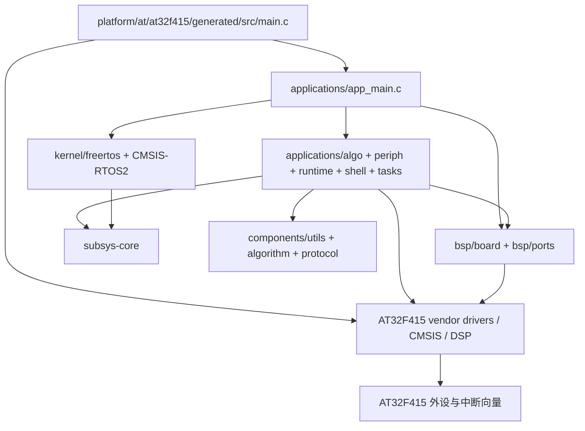
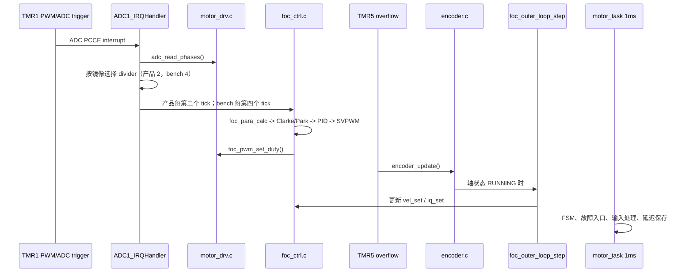

# 架构与运行时

## 1. 架构总览

当前工程是一个面向 `AT32F415` 的单轴 FOC 固件。系统用 CMake target 把平台、内核、共享机制、可复用算法、BSP 和产品应用组合成一个固件目标；产品语义集中在 `applications`，而 FOC 热路径保持硬件耦合和直接调用。



### 1.1 分层职责

| 层 | 当前目录 | 负责什么 | 明确不负责什么 |
| --- | --- | --- | --- |
| 平台 | `platform/at/at32f415`、`platform/cpu/cortex-m3-soft` | startup、linker、芯片头文件、生成式外设初始化、CMSIS/DSP、CPU/FreeRTOS port 元数据 | 产品任务、Shell 语义、参数策略 |
| BSP | `bsp/board` | 板级初始化、板级 Flash 后端、板级事实 | FOC 产品任务、Shell 命令、复制 vendor 驱动栈 |
| 薄端口 | `bsp/ports` | console、system reset 等功能性控制面端口 | FOC ISR 热路径、通用 HAL/vtable/device registry |
| 共享机制 | `subsys` | export、runtime、IPC、日志、时间、Shell transport 基础、任务预算 | FalconFoc 产品行为 |
| 可复用组件 | `components` | PID、过滤器、通用容器、CRC、环形队列、VOFA 协议等 | 芯片寄存器、BSP 事实、产品状态机 |
| 产品应用 | `applications` | FOC 算法与外设适配、运行时策略、状态机、Shell 命令、校准、参数恢复/保存 | 平台启动代码和通用硬件抽象 |

设计基线见 `docs/architecture/Themis_FalconFoc无devdrv模式与FOC直控分层方案.md`；该文档仍是架构意图，但其中的 MCU 名称需要以当前 `AT32F415` 源码为准。

## 2. 启动链

### 2.1 生成式入口

`platform/at/at32f415/generated/src/main.c` 按固定顺序执行：

1. `wk_system_clock_config()`：HICK/PLL，当前源码配置 150 MHz；
2. `wk_periph_clock_config()`、`wk_debug_config()`、`wk_nvic_config()`、`wk_timebase_init()`；
3. GPIO、ADC1、DMA1、USART1、SPI1、TMR1、TMR5、TMR3 初始化；USART2/DMA3/4 保留为生成式但主入口当前注释掉；
4. `app_main_bootstrap()`；
5. 主循环为空，实际工作由中断和 RTOS 任务承担。

平台 owner 和 linker/startup 路径由 `platform/at/at32f415/ThemisPlatformDefaults.cmake` 声明：

- platform target：`at32f415-hal`；
- entry：`generated/src/main.c`；
- startup：`vendor/cmsis/cm4/device_support/startup/gcc/startup_at32f415.s`；
- linker：`.../AT32F415xB_FLASH.ld`；
- motor soft IRQ：`TMR5_GLOBAL_IRQHandler`；
- flash：`0x08000000`，128 KiB，sector 1 KiB，128 sectors。

### 2.2 应用桥和 export

`applications/app_main.c` 的 `app_main_bootstrap()` 是生成式入口到产品应用的唯一桥：

```text
bsp_init()
  -> export range: PRE_KERNEL
  -> osKernelInitialize()
  -> export range: POST_KERNEL ... APP
  -> osKernelStart()
```

每个阶段失败都会记录 boot stage/status，并进入 `_app_boot_halt()`；错误信息来源包含 `tm_export_last_error`。应用启动不应回退到历史 BSP task 路径。

当前 APP export 的关键 owner 是：

```text
motor_task_init()
  -> shell_task_init()       [SHELL_ENABLE=1]
  -> motor_runtime_init()
  -> motor_runtime_attach()
  -> osThreadNew(_motor_task_entry)
  -> osThreadNew(_motor_safe_task_entry)
```

`motor_task_init()` 位于 `applications/tasks/motor_task.c`，通过 `INIT_EXPORT(..., EXPORT_LEVEL_APP)` 注册。

## 3. 实时调度与调用边界

### 3.1 高频控制路径



`applications/tasks/motor_task.c` 是硬件中断与产品控制算法的连接点：

- `ADC1_IRQHandler()` 只确认/清除 PCCE、读取三相电流，然后按镜像 divider 调度 FOC；默认产品每两个 ADC tick 为 10 kHz，bench 每四个 ADC tick 为 5 kHz；校准期间改走 `foc_calib_loop()`；
- `THEMIS_PLATFORM_MOTOR_SOFTIRQ_HANDLER` 在当前平台展开为 `TMR5_GLOBAL_IRQHandler()`，清除 TMR5 overflow 后调用 `encoder_update()`，RUNNING 时调用 `foc_outer_loop_step()`；
- `motor_task` 以 1 ms 周期执行状态机、`foc_fault_check()`、输入模式/轨迹和校准收尾；
- `motor_safe_task` 以 10 ms 周期执行 deferred save，并以约 100 Hz 发送 VOFA JustFloat。

当 `TM_BENCH_DIAG=1` 时，bench 镜像通过编译契约强制
`TM_FEATURE_VOFA=0`，因此上述安全任务仍负责延迟保存，但不产生 VOFA
二进制输出；Shell 仍是停机后诊断导出边界。

生成式 `at32f415_int.c/.h` 将 ADC1 和 TMR5 handler 留给 `motor_task.c`，避免重复定义；这是平台中断向量与应用 owner 的边界。

### 3.2 当前时基的事实与差异

| 概念 | 当前代码值/来源 | 解释 |
| --- | --- | --- |
| TMR1 生成 ARR | `wk_tmr1.c:111` 为 `3749`，TMR1 双向计数 | 结合 150 MHz 时钟，生成式配置意图为约 20 kHz PWM/ADC 触发 |
| FOC step | 默认产品每两个 ADC tick，`PWM_FREQ_HZ=10 kHz`；bench 每四个 ADC tick，`PWM_FREQ_HZ=5 kHz` | TMR1/ADC 载波仍约 20 kHz；bench 通过 `TM_BENCH_DIAG=1` 让 `PWM_DT=200 us` 与软件 cadence 一致 |
| 外环/编码器 | `TMR5` ARR `1999`、预分频 `14`，`foc_config.h` 设 `VEL_LOOP_FREQ_HZ=5000` | 按 150 MHz timer clock 静态推导约 5 kHz；实际 ISR 抖动仍未实板测量 |
| 位置环 | `POS_LOOP_DIVIDER` 在外环中每 5 次执行一次 | 配置目标为 1 kHz |
| 轨迹任务 | `foc_process_input_task()` 在 motor task 1 ms 循环中调用 | `traj_trap` 以 `TRAJ_TASK_TS=1 ms` 更新 |

`foc_ctrl.c` 的历史注释不能替代当前 owner：实际路径是 ADC1/TMR1 CH4 触发，约 20 kHz ADC tick；默认产品每第二个 tick 执行 10 kHz FOC，bench 每第四个 tick 执行 5 kHz FOC。编码器/外环由 TMR5 soft IRQ 约 5 kHz 驱动。上述频率是由生成配置和时钟树静态推导，仍不是示波器/板级 profiling 结果。

bench 镜像还在 ADC ISR 内维护约 50 ms 的运行预算；预算到期时只锁存 `FAULT_COMM_ERROR`
并关闭 PWM，不依赖 Shell 是否及时处理 `state disable`。该护栏是诊断能量上限，不是产品
级独立硬件保护。

### 3.3 热路径与软任务边界

| 路径 | 选用文件 | 允许的工作 | 明确禁止/不负责 |
| --- | --- | --- | --- |
| FOC 热路径 | `motor_task.c`、`motor_drv.c`、`foc_ctrl.c`、`foc_core.c`、生成式 `wk_adc.c`/`wk_tmr.c` | ADC 快照、Clarke/Park、LPF、PI、解耦、反 Park、SVPWM、TMR1 duty 更新；可直接使用 vendor 寄存器/头文件 | 不打印、不写 Flash、不等待无界资源、不承担 Shell/产品策略 |
| 编码器/外环 soft IRQ | `motor_task.c`、`encoder.c`、`foc_ctrl.c` | TMR5 事件清除、SPI1 编码器读取、PLL、速度/位置外环 | 当前 SPI 读取仍是 blocking；不应把它误当作 FOC ADC 热路径 |
| 产品任务 | `motor_task.c`、`motor_fsm.c`、`motor_runtime.c`、`motor_fault_runtime.c` | FSM、输入模式、故障收敛、参数恢复请求和校准收尾 | 不在异常保护路径中依赖串口输出或 Flash 写入 |
| 安全任务 | `motor_safe_task.c`、`motor_runtime.c` | 延迟保存、遥测和停机后的数据消费 | 不替代 ADC ISR 的快速关断 |

生成式 `platform/at/at32f415/generated/` 是时钟、GPIO、ADC、SPI、TMR 和 NVIC 的配置事实来源；应用层只在 FOC 硬件耦合边界使用这些事实，Wiki 不把历史 AT32F403A 文档当作当前配置。

## 4. 硬件与平台映射

### 4.1 ADC/电流/电压

`wk_adc.c` 的 ADC1 injected/preempt group 当前配置为：

| 信号 | GPIO | 处理位置 |
| --- | --- | --- |
| VBUS | PA1 / ADC1 channel 1 | `adc_read_phases()` 中换算总线电压 |
| IC | PA4 / channel 4 | 三相电流读取 |
| IB | PA5 / channel 5 | 三相电流读取 |
| IA | PA6 / channel 6 | 三相电流读取 |

触发源为 TMR1 CH4，`CCR4=3740`，用于 PWM 同步采样低侧电流。`motor_drv.c` 通过 `FAC_CURR`、`FAC_VBUS` 和 DRV8311H 电流符号规则完成原始 ADC 到工程量的转换。

普通 ADC DMA 读取函数在当前 `motor_drv.c` 中仍是注释/空实现；当前 FOC live path 是 injected group，不应把普通 ADC API 当作实时路径。

### 4.2 PWM/编码器/通信

| 外设 | 当前用途 | 当前 owner |
| --- | --- | --- |
| TMR1 CH1/2/3 + complementary | 三相 SVPWM 和互补输出 | generated init + `motor_drv.c` duty/enable/disable |
| TMR1 CH4 | ADC 触发 | generated init |
| SPI1 | KTH7823 编码器，PA15 软件片选 | `encoder.c` + generated SPI1 |
| TMR5 | 编码器更新与外环 soft IRQ | `motor_task.c` |
| USART1 PB6/PB7 | Shell console，DMA RX/TX，IDLE | `bsp/ports` + `shell_task.c` |
| USART2 PA2/PA3 | 生成式辅助串口 | 当前 main 不启动，非 live Shell path |
| TMR3 CH4 | 生成式辅助输出/比较 | 当前应用主链未使用 |

当前 generated USART1 是 115200、8N1；正式治理文档中的 `COM54@1000000` 是历史/基线事实，本 Wiki 不将其当作当前运行配置。

### 4.3 CPU 类

`platform/cpu/cortex-m3-soft/ThemisCpuClassDefaults.cmake` 定义：

- Cortex-M3；
- 无 FPU；
- soft float；
- FreeRTOS `portable/GCC/ARM_CM3`；
- `ARM_MATH_CM3`。

这解释了 `foc_config.h` 把 FOC step 设为 10 kHz、当前电流环带宽调低到 250 Hz 的设计取向，但它不能替代运行时 profiling。

## 5. 产品状态与数据模型

中心对象是 `struct motor_dev`，定义在 `applications/algo/foc_common.h`。它聚合：

```text
motor_hw_config       电机/编码器/电气参数
motor_prot_config     电压、电流、速度、温度保护阈值
motor_ctrl_config     PID、带宽、斜坡、轨迹
motor_calc_params     kt、ke、倒数等派生量
motor_ctrl_state      setpoint、feedforward、动态限幅、I-f/电压开环状态
motor_meas_data       电流、电压、温度、角度、速度、位置
encoder_state         原始计数、PLL、LUT、累计圈数
motor_calib_state     校准状态、有效标志、延迟保存 bitmask
FSM/mode/fault_code   产品状态和故障结果
```

核心枚举是：

- 控制模式：`VOLT`、`CURR`、`VEL`、`POS`；
- 输入模式：`INACTIVE`、`PASSTHROUGH`、`VEL_RAMP`、`TORQUE_RAMP`、`POS_FILTER`、`VEL_FILTER`、`TRAP_TRAJ`、`TUNING`；
- 轴状态：`IDLE`、`CALIB`、`RUNNING`、`FAULT`；
- 故障：过流、过压、欠压、超速、电机/驱动温度、传感器、校准、通信。

### 5.1 FSM 安全语义

`applications/tasks/motor_fsm.c` 的状态表核心行为：

| 当前状态 | 事件 | 目标状态 | 关键副作用 |
| --- | --- | --- | --- |
| IDLE | START | RUNNING | 进入运行；未校准编码器只告警，不阻止启动 |
| RUNNING | STOP | IDLE | 清理运行状态 |
| FAULT | CLEAR_FAULT | IDLE | 允许恢复前的清理 |
| IDLE/CALIB | CALIB_MOTOR/ENC | CALIB | 准备相应校准 |
| CALIB | CALIB_ABORT/DONE | IDLE | 恢复编码器或派生状态 |
| 任意 | DISABLE | FAULT | 设计为安全停机，确保 PWM disabled |
| IDLE/CALIB/RUNNING | FAULT_TRIP | FAULT | 关闭 PWM、清 setpoint/PID/Foc calc |

进入 IDLE 时会恢复参数后的派生状态，并将 PWM 置于主动钳位的 0% 初始值；进入 FAULT 时关闭 PWM 并复位 PID/setpoint。`DISABLE -> FAULT` 不是普通停止语义，而是安全策略。

### 5.2 故障快照与诊断写入边界

`motor_fault_runtime.c` 在 ADC 快速保护路径中只允许完成数值检查、首次
`motor_fault_context` RAM 锁存、故障码锁存和 `pwm_out_disable()`。上下文
锁存发生在 PWM 禁止之前，不调用 Shell、日志、Flash 或阻塞接口；
`motor_fault_context_read()` 由停机后的 Shell/诊断路径消费，启动初始化或
显式 `fault clear` 才清除。`motor_runtime_snapshot()` 则复制正常运行时的
raw ADC、offset、相电流、开环角度/速度、FOC 电压和 SVPWM 输出，供 `obs`
在手动 disable 后继续读取。

`motor_runtime_request_set_passthrough()` 以及 `motor_runtime_diag_set_*()`
的写入口统一要求 `AXIS_STATE_IDLE`；Shell 先用 snapshot 返回
`reason=idle_only`，runtime 再做同一约束，避免绕过 Shell 直接改变运行中的
电压、I-f、相电压、带宽、PID 或 encoder offset。

## 6. 参数、校准与控制数据流

### 6.1 控制级联

```text
Shell/上层请求
  -> motor_runtime_request_*()
  -> motor_ctrl_state target/setpoint 或 motor_fsm event
  -> foc_process_input_task()  [1 ms，生成 ramp/traj setpoint]
  -> foc_outer_loop_step()     [TMR5，位置/速度级联]
  -> iq_set
  -> foc_current_loop_step()   [ADC，每二次触发]
  -> PWM duty
```

`CTRL_MODE_VOLT` 走 `theta_sim + we_volt_ramp` 的电压开环；`if_enable` 时仍使用当前环跟踪 I-f 电流；其他模式使用编码器 PLL 的电角度进入电流环。

### 6.2 参数持久化

参数被划分为 `ENC`、`MOTOR`、`SYS` 三组，使用各自 A/B slot、magic、version、sequence 和 CRC。应用层只提出保存请求，安全任务消费 bitmask；实际 Flash 操作通过 `bsp_flash`。

```text
calibration/runtime/shell
  -> param_save_req |= PARAM_SAVE_*
  -> motor_safe_task (10 ms)
  -> foc_param_save_enc/motor/sys()
  -> bsp_flash_write/erase()
```

Flash 操作不能从 ISR 执行；`bsp_flash_write()`/`erase()`要求 scheduler 已运行、非 ISR、写入 4 字节对齐，并在 vendor flash 操作期间关中断。

### 6.3 校准链

```text
current offset (Welford, 2000 x 1 ms)
  -> Rs -> Ls -> flux -> Js
  -> encoder I-f drag: pole pair/direction/phase/LUT/offset
  -> refresh derived params and gains
  -> request deferred ENC/MOTOR save
```

校准主循环由 ADC ISR 进入 `foc_calib_loop()`，而参数保存被延后到安全任务；这是“实时计算”和“不可在 ISR 做的持久化”之间的明确边界。

当前默认 `FOC_ENERGIZED_CALIB_ENABLE=0U`：FSM 的电机参数校准和编码器带电校准动作在进入 `AXIS_STATE_CALIB` 前直接拒绝；只有上电后不施加明显相电压/相电流的电流偏置校准保留。该门禁属于应用策略，不改变 FOC 热路径和当前 `1.00 A` 临时 bring-up 快速过流阈值。

## 7. 边界决策

- FOC hot path 允许直接使用 AT32 vendor header、generated code 和寄存器；不要为了形式上的可移植性把 ADC/PWM/编码器热路径包进深层 HAL。
- Shell、reset、Flash 等 soft-task/control-plane 表面经过 `bsp/ports` 或 `bsp/board` 薄接口。
- `subsys` 只提供机制，不承载电机产品策略；产品状态、Shell 命令、保存恢复策略归 `applications`。
- vendor/CMSIS/DSP 不在本 Wiki 展开函数级说明，只记录被选用的目录/文件、服务内容和上层调用边界，详见 [modules.md](modules.md#8-第三方与生成式代码范围)。

当前无板验证不会解除功率级准入。由于 `nFAULT/nSLEEP` 尚未形成 MCU/独立监控闭环，TMR1 Break 关闭且 deadtime 为 0，12 V/1 A 不能替代物理急停，实机状态保持：

```text
REAL_BENCH_TEST_STATUS=BLOCKED
```

## 8. 2026-08-30 分层正交诊断的架构边界

`[源码确认]` 新增 bench 诊断仍遵守“FOC 热路径直接、诊断数据停机后读取”的分层原则：

```text
TMR1/ADC ISR
  -> FOC calculation
  -> RAM-only trace sample (bench only)
  -> fast fault trip (constant-time)

shell task (stopped/IDLE gate)
  -> trace/map/trigger/encoder commands
  -> bounded text response
```

- `applications/periph/motor_bench_mapping.*` 只拥有实验映射表和 ADC 触发合法性检查；它
  不拥有产品相序策略，也不改变 FOC 数学。
- `applications/runtime/motor_runtime.*` 只拥有运行态写入门禁和对外诊断入口；运行中写
  入返回 `idle_only`，不能由 Shell 改变正在运行的矢量、映射或采样点。
- `applications/runtime/motor_fault_runtime.*` 拥有首故障上下文和 bench 环形采样存储；
  它不负责打印和 Flash 持久化。
- `applications/periph/encoder_bench_trace.*` 只记录编码器观测，不执行编码器校准，也不
  介入电机控制入口。
- `scripts/flows/board/run_bench_matrix.ps1` 是控制面编排器，不是保护器；它不能替代
  MCU 快速保护、DRV8311H 保护或人工断电。

`[静态推导]` 由于 trace 在 FOC 计算后采集，记录中的软件 CCR、软件电流和软件角度可以
建立调用链相关性，但不能证明引脚上真实互补波形、功率级开关重叠或 ADC 采样孔径。上述
物理结论必须保持为 `[实板未验证]`，直到有独立测量证据。
