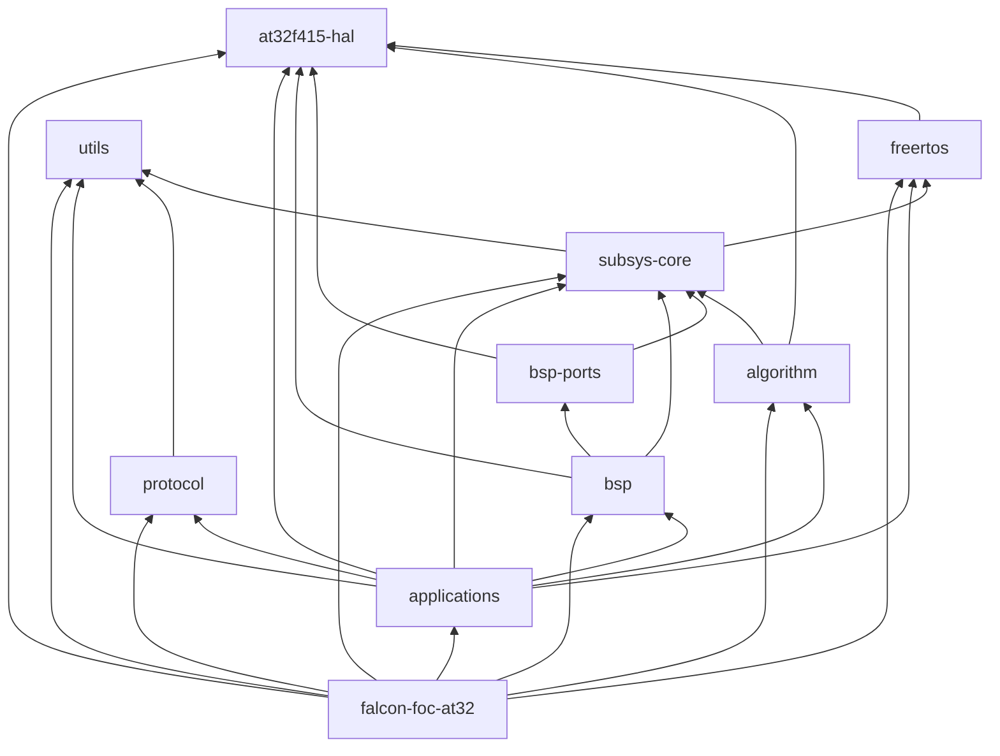
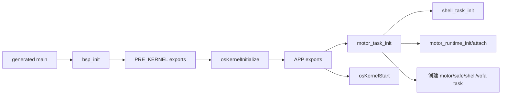
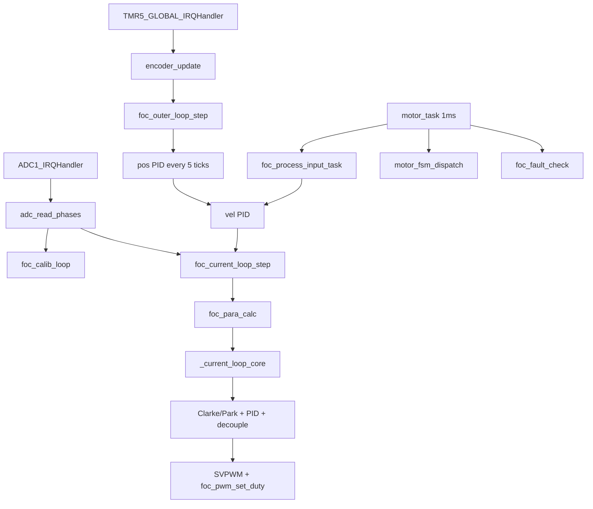
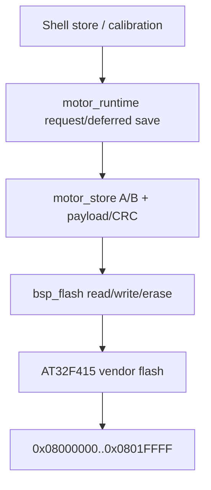

# 依赖关系与数据流

## 1. CMake target 图



这是链接/target 关系，不等于每个 C 文件都直接 include 所有依赖。具体 target 定义位于：

- `CMakeLists.txt`：顶层选项、firmware target、host tests 开关；
- `platform/at/at32f415/CMakeLists.txt`：generated/vendor/CMSIS/DSP 选取；
- `kernel/freertos/CMakeLists.txt`：kernel、CMSIS-RTOS2、ARM_CM3 port、heap；
- `subsys/CMakeLists.txt`：共享机制；
- `components/{utils,algorithm,protocol}/CMakeLists.txt`：通用算法、协议、工具；
- `bsp/{board,ports}/CMakeLists.txt`：板级和薄端口；
- `applications/CMakeLists.txt`：产品应用全集合；
- `tests/CMakeLists.txt`：明确的主机测试 target。

## 2. 编译配置依赖

### 2.1 主机模式

`host-base` 预设的关键条件：

```text
THEMIS_BUILD_FIRMWARE=OFF
THEMIS_BUILD_HOST_TESTS=ON
```

主机测试额外定义 `THEMIS_HOST_TEST=1`，并使用 `tests/host/support` 的 RTOS、BSP、runtime 替身。它的目标是验证边界/契约，不模拟寄存器时序或真实电机。

### 2.2 固件模式

`fw-base` 的关键条件：

```text
toolchain = tools/cmake/arm-gcc-toolchain.cmake
THEMIS_BUILD_FIRMWARE=ON
THEMIS_BUILD_HOST_TESTS=OFF
THEMIS_FIRMWARE_TARGET_NAME=falcon-foc-at32
THEMIS_PLATFORM_VENDOR=at
THEMIS_PLATFORM_SOC=at32f415
```

平台元数据继续选择：

```text
SOC          -> platform/at/at32f415
CPU class    -> platform/cpu/cortex-m3-soft
MCU header   -> at32f415.h
soft IRQ     -> TMR5_GLOBAL_IRQHandler
linker       -> AT32F415xB_FLASH.ld
```

当前预设有：

- `fw-tiny-carrier-minsizerel`；
- `fw-tiny-headless-minsizerel`；
- `fw-standard-carrier-minsizerel`；
- `fw-full-diag-carrier-debug`。

`include/config/tm_core_config.h` 默认 profile 是 full-diag、flavor 是 carrier-demo；full-diag 才默认打开 Shell，VOFA 默认打开，FreeRTOS heap 为 10 KiB。专用 `fw-full-diag-carrier-bench-debug` 通过 `THEMIS_ENABLE_BENCH_DIAG` 注入 `TM_BENCH_DIAG=1`，再强制关闭 VOFA 和带电校准，不改变默认三种固件。

## 3. 启动依赖图



注意：`shell_task_init()` 当前由 `motor_task_init()` 显式调用，并非独立的产品启动 owner；`vofa_task` 是应用 target 中的任务模块，是否创建受当前 feature/profile 路径影响。

## 4. 高频源码调用图



实际代码在 ADC 中用半频 divider 选择 CALIB 或 current-loop 路径；图中的两个分支不是同一 tick 同时执行。

## 5. 关键调用边

### 5.1 启动/任务边

| caller | callee | 关系类型 | 说明 |
| --- | --- | --- | --- |
| generated `main` | `app_main_bootstrap` | 入口调用 | 平台完成外设初始化后移交应用 |
| `app_main_bootstrap` | `bsp_init` / export range / CMSIS OS | 顺序调用 | 启动失败进入 halt |
| `motor_task_init` | `shell_task_init` | 显式初始化 | 仅 Shell feature 打开时 |
| `motor_task_init` | `motor_runtime_init/attach` | 对象初始化/绑定 | 任务创建前完成 |
| `motor_task_init` | `osThreadNew` | 任务创建 | motor task + safe task |
| `shell_task_init` | `tm_shell_task_init` | transport/session 连接 | 创建有界 app Shell 队列与 session task |
| safe task | `motor_runtime_process_deferred_save` | 安全上下文调用 | 消费 save bitmask |

### 5.2 控制边

| caller | callee | 线程/中断上下文 | 数据边界 |
| --- | --- | --- | --- |
| ADC1 handler | `motor_drv.adc_read_phases` | ISR | ADC raw -> `meas_data` |
| ADC1 handler | `foc_calib_loop` | ISR | 校准状态和测量值，不写 Flash |
| ADC1 handler | `foc_current_loop_step` | ISR | measurements/setpoints -> duty |
| TMR5 handler | `encoder_update` | ISR | SPI raw -> PLL/LUT/angle/velocity |
| TMR5 handler | `foc_outer_loop_step` | ISR | pos/vel -> `iq_set` |
| motor task | `foc_process_input_task` | RTOS task | command target -> setpoint |
| motor task | `motor_fsm_dispatch` | RTOS task | event -> axis state |
| Shell session | `motor_runtime_request_*` | RTOS task | text command -> typed request |

### 5.3 Shell 边

```text
DMA RX ring
  -> shell_task.c::_process_dma_rx
  -> app_shell_task.c::tm_shell_task_submit_line
  -> static CMSIS message queue
  -> app_shell_task session thread
  -> shell command registry / app_shell_cmd_*.c
  -> motor_runtime snapshot/request
```

发送方向是：

```text
TM_SHELL_SUMMARY/ROW
  -> shell_task async framed TX ring
  -> bsp_console_write_poll
  -> USART1 DMA/寄存器路径
```

队列和 TX ring 都有固定容量；满时记录丢弃/失败，不动态分配内存。

## 6. 参数持久化依赖和布局

### 6.1 层次



### 6.2 group 与保存 bit

| bit | group | payload 内容 | 运行时影响 |
| --- | --- | --- | --- |
| `PARAM_SAVE_ENC=0x01` | encoder | LUT[128]、offset、pole pairs、phase order/direction、valid | encoder 配置/LUT，恢复后刷新位置相关派生量 |
| `PARAM_SAVE_MOTOR=0x02` | motor | hw/protection、4 组 PID、ramp、trajectory、bandwidth | 重置 PID 并应用电机/控制参数 |
| `PARAM_SAVE_SYS=0x04` | system | default ctrl/input mode | 恢复控制/输入模式，非法枚举回退 |
| `PARAM_SAVE_ALL=0x07` | all | 三组 | Shell `store erase` 固定全量 |

### 6.3 当前 F415 地址推导

当前 platform metadata 提供：

```text
BSP_FLASH_BASE_ADDR = 0x08000000
BSP_FLASH_SIZE      = 0x00020000  (128 KiB)
BSP_FLASH_SECTOR_SIZE = 0x400       (1024 B)
FLASH_END           = 0x08020000
```

`motor_store.c` 以 `_FLASH_END` 和 `_SECTOR_SZ` 推导六个 slot，每组各一对 A/B：

| group | A | B |
| --- | ---: | ---: |
| SYS | `0x0801FC00` | `0x0801F800` |
| MOTOR | `0x0801F400` | `0x0801F000` |
| ENC | `0x0801EC00` | `0x0801E800` |

单组保存使用 magic/version/sequence/CRC 检查两个 slot，选择有效且序列更新者；写入选择无效/旧 slot，内容相同则跳过。擦除顺序是 ENC -> MOTOR -> SYS。

这是当前固件地址推导，不能与主机测试替身混淆：`tests/host/support/bsp_flash.h` 仍使用 1 MiB、2 KiB sector、512 sectors 的旧几何，主机测试因此主要证明协议/状态，不证明 F415 真实 Flash 地址。

## 7. 配置依赖与数据所有权

| 配置/事实 | 定义位置 | 消费者 |
| --- | --- | --- |
| feature/profile/flavor/heap/task stack | `include/config/tm_core_config.h` | CMake、tasks、Shell、VOFA |
| Shell queue/RX/TX/priority | `applications/config/console_session_config.h` | shell transport/session |
| motor/safe stack | `applications/config/motor_task_config.h` | `motor_task.c` |
| ADC/pin/timer/mcu generated facts | `platform/at/at32f415/generated/inc/at32f415_wk_config.h`、`wk_*.c` | generated init、periph/BSP |
| 电机/PID/时基默认值 | `applications/algo/foc_config.h` | runtime、FOC、校准 |
| board console/flash symbols | `bsp/bsp_config.h`、platform metadata | BSP/Flash/console |

原则是：generated/platform 拥有芯片事实，`foc_config` 拥有产品默认参数，`motor_runtime` 拥有运行时应用策略；不能让 Shell 直接写 generated 文件来实现产品行为。

## 8. 主机替身边界

主机测试通过编译定义或替身实现隔离以下依赖：

- RTOS 线程、队列、临界区；
- BSP console/reset/flash；
- encoder/PWM/LPF/参数保存等硬件或运行时辅助；
- `THEMIS_HOST_TEST` 下的 host-only process API。

因此主机测试可以证明“某个请求是否产生正确状态/错误码/队列行为”，不能证明：

- ADC/PWM 实际寄存器配置；
- IRQ 周期、ISR 抖动、soft-float 执行时间；
- SPI blocking 读取是否满足实时 deadline；
- 电机闭环稳定性、驱动器保护响应和真实温升。

## 8. 本计划新增依赖与验证边界

### 8.1 停机故障上下文依赖

```text
ADC1_IRQHandler
  -> foc_fault_check_fast()
  -> _capture_fault_context()      [首次 fault，RAM-only]
  -> motor->fault_code |= reason
  -> pwm_out_disable()
  -> fault status / obs all        [停止后 Shell 读取]
```

`motor_fault_context` 是单电机、首次故障优先的上下文；重复 trip 不覆盖，
清除动作由 `motor_runtime_request_axis_action(CLEAR_FAULT)` 成功后执行。
正常 `state disable` 不清除 `motor_runtime_snapshot` 的最后测量/控制值。
这条路径依赖 Shell/串口只做停机后导出，实时安全不依赖输出通道。

### 8.1.1 诊断写门禁

`diag` Shell 和 `motor_runtime` 各自检查 `AXIS_STATE_IDLE`。Shell 负责给出
人类/脚本可识别的 `result=error reason=idle_only`；runtime 是最终调用边界，
阻止直接 API 调用改变 `vq/vd`、I-f、dp、passthrough、currbw、PID 或 encoff。

### 8.2 带宽参数到 LPF 的依赖

```text
foc_param_load_motor()
  -> motor->ctrl_config.curr_bandwidth
  -> foc_lpf_init()                    [runtime init，初始化输出/系数]

diag set currbw
  -> 合法性检查（finite 且 > 0）
  -> foc_curr_gain_calc()
  -> foc_lpf_refresh()                 [只更新系数，保留输出]
```

因此 PI 参数和 Id/Iq LPF 系数由同一份有效 `curr_bandwidth` 派生；非法 `currbw` 不进入上述更新链。`foc_lpf_refresh()` 位于 `applications/periph`，由 runtime 调用，不能反向拥有 Shell 或持久化策略。

### 8.3 无板开环测试依赖

`test_foc_voltage_openloop_model_contract` 使用真实的 `foc_current_loop_step()`、`foc_ctrl_volt()`、`foc_svpwm()` 和 PID 实现，只有 PWM 输出函数由 host stub 截获。`test_motor_fsm_calibration_gate_contract` 使用 FSM 的真实实现，但将校准准备、编码器初始化和 PWM 操作替换为可计数 stub。两者都不接触 AT32F415 寄存器。

### 8.4 外设配置静态契约

`scripts/flows/host/check_foc_peripheral_contract.ps1` 是只读依赖检查器：

```text
generated clock/NVIC + wk_tmr.c + wk_adc.c + wk_spi.c
  + generated pin header
  + motor_drv.c/foc_ctrl.c mapping and VBUS guard
  -> FOC_PERIPHERAL_CONTRACT=PASS
```

它检查生成源码的实际调用和赋值文本；脚本通过不等于示波器、驱动器保护脚或 ADC 采样窗口的实板证明。

本轮 host 测试注册目标为 38 个；最终数量以当前命令输出为准，任何新增目标必须同时进入 `run_host_tests.ps1` 和 CTest。

无板依赖闭环不等价于功率级闭环。当前 DRV8311H 的 `nFAULT/nSLEEP`、TMR1 Break/deadtime 和物理急停仍需独立证据，因此：

```text
REAL_BENCH_TEST_STATUS=BLOCKED
```

## 9. 2026-08-30 正交诊断依赖闭环

`[源码确认]` bench 诊断的依赖链如下：

```text
AT32F415 TMR1/ADC registers
  -> motor_drv.c phase read / PWM write
  -> FOC current or voltage step
  -> motor_fault_runtime RAM trace
  -> stopped-only Shell read
```

```text
SPI1 encoder read
  -> encoder.c state update
  -> encoder_bench_trace RAM ring (bench only)
  -> stopped-only Shell read
```

```text
Shell command
  -> motor_runtime IDLE/stopped gate
  -> mapping/trigger setter
  -> motor_drv hardware-coupled write
```

依赖约束：

- `[源码确认]` 64 条 FOC trace 和 32 条编码器 trace 只存在于 bench 编译；普通产品镜像
  不分配这些环形缓冲，也不暴露相应命令。
- `[源码确认]` map/trigger setter 只使用 RAM，重启恢复默认；它们不依赖参数持久化、校准
  存储或外部设备。
- `[无板验证]` 新增测试目标已加入 `tests/CMakeLists.txt`，host flow 和独立 CTest 均
  执行。主机替身验证的是 API、边界和数学，不验证 AT32F415 引脚时序。
- `[实板未验证]` 真实 PWM 引脚、DRV8311H 半桥、CSA 建立时间、采样窗口和机械响应不在
  主机依赖闭环内，必须保持独立实板证据标签。

bench 证据可以回答“软件把哪个 phase 值写到哪个 CCR、在何时读取哪个 ADC rank、角度和
软件电流如何变化”，不能单独回答“DRV 输出是否正确、死区是否足够、电机是否有转矩或
是否长期热稳定”。
