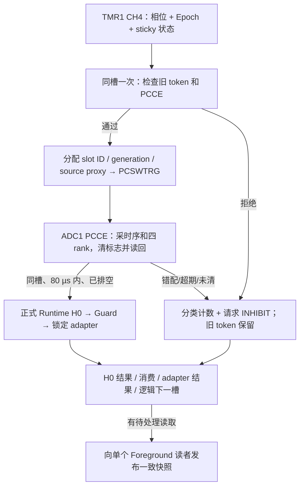

# NEXT-RT-01｜逻辑周期身份与 ADC–H0 采样交接

**RT-01 SAMPLE PERIOD IDENTITY & ADC HANDOFF SOFTWARE PASS**  
**PHYSICAL ADC/PWM TIMING NOT VERIFIED**

## 基线与变更范围

工作树 `D:/study/Software/Hollow-Gimbal-vm01a`，分支 `codex/falconfoc-v2-vm01a`，本地 HEAD `d824933946a365b8081089c2e396d77b3f661bc8`。开始时暂存区为空，远端跟踪基线为 `34417392cd94932058e659442881a4bcc73eb695`，本地已有两个分支提交和未提交的 ARCH-00 交付。ARM before 从该工作树在 RT-01 修改生产代码前构建。ARCH-00 的历史报告和原始产物保留，现有测试向下扩展。

沿用独立 C11 Core、H0/H1/Foreground、SPI IRQ、`sched KEEP_UNUSED` 和锁定输出。新增生产代码只位于 Board 计时 API、`foc_board.c` 与 `main.c`。Runtime、Pipeline、Safety、控制律、Legacy、UART V1、SOFT 配置存储格式、标定和 Trace v1 的源差异为空。 [ARCH-00 证据](2026-11-19-next-arch-00.md) · [执行 ADR](../architecture/FalconFOC_BareMetal_Execution_ADR.md)

## Epoch、逻辑槽与 IRQ 证据

1. 启动在既有 IRQ 关断窗口内清零 TMR1 和 TMR2，TMR2 先启动，读 TMR1 初相位及 TMR2 前值，使能 TMR1 后再读 TMR2。要求 TMR1 启动初相位为零、启用前后的 TMR2 时间跨度 ≤2 µs。失败不启动 ADC IRQ 服务。上下文只接受一次初始化。
2. 两个同级 IRQ 各取一份 `TMR2 → TMR1 CNT → TMR2` 的有界观察，同时检查计数方向、使能、周期、分频及比较配置。标志读数在观察前后改变时最多重读一次。TMR1 overflow、TMR2 32 位 overflow 和内部 CH1 `0x80000000` 半程比较为 sticky 见证，读取后由同一个 IRQ owner 组清除。TMR2 无 NVIC、DMA、引脚输出。PCCE 与 TMR1 CH4 的 NVIC 优先级保持 0，TMR5/SPI1 为 1，USART1 为 2。
3. 由 TMR2 前后读数、TMR1 实测相位和微秒量化误差形成槽边界区间。它必须与启动区间平移整数个 200 µs 后相交，并与 overflow 见证一致。区间远短于槽宽，满足时最多有一个候选。槽身份 `slot_id` 依经过槽数推进，generation 只在准许触发时推进，两者独立。时间和身份使用 uint32 模运算，计数器独立饱和。
4. 两次观察之间的真实间隔须小于半范围。短间隔跨 uint32 零点使用 overflow 见证；半程与 overflow 都出现、任一标志与时间区间不符、配置/相位失配或 bracket 不可靠，都进入 `AMBIGUOUS_CLOCK`。失效 epoch 不自动重建，即使后续相位恢复，也需新启动上下文。连续不可观测期间保留之前的可信统计，不虚构采样时刻。

模型假设 TMR1/TMR2 按固定配置持续计数，所读 sticky 标志符合参考手册。独立状态仍需板端验证，包括 32 位比较、短暂跨界的标志时序和调试器冻结策略。只在两次观察间发生并恢复、且同时保留相位和所有可见标志的故障无法由这些寄存器区分。例如多槽间隔中的整周期暂停可能与未服务事件等价。正常固件没有暂停/重启计时器的运行入口，不能用当前诊断证明真实硬件从未停顿。 [AT32F415 RM Rev 2.05 §14](https://www.arterytek.com/download/RM/RM_AT32F415_V2.05_EN.pdf) · [寄存器绑定](../../firmware/at32f415/src/main.c) · [Board 时间判定](../../firmware/at32f415/src/foc_board.c)

## ADC 事务、取消和诊断

- CH4 处理相位须在 40…110 µs。前一槽滞留的旗标若在本槽比较前被处理，拒绝当前请求；若标志合并且当前相位可信，只能归属当前逻辑槽。准许请求时记录 `PENDING`、槽、generation、TMR2 请求时间和下一逻辑槽边界。请求时间为 PCSWTRG 前的软件源时间代理，实际 ADC aperture 与软件时间偏差待测。
- 下一候选到来时旧 token 仍在处理，则保留原身份并转 `DRAIN`，拒绝新转换。ADC IRQ 中只有一个拥有者读取 ranks 和确认 PCCE 清除，对未清、无 token、跨槽、超过 80 µs 或坏 rank 做分类。无法确认排空时不得释放 token。没有排空且没有后续可服务 IRQ 时，软件停机位可置起，不能据此证明实体关断。
- 超期/错配的旧帧不调用 H0。身份及时但 rank 无效的既有停机服务可进入 H0 的 STOP 路径，该帧不计为有效消费。STOP/FAULT 仍经 Runtime 的原子 OR 累积和原有 Guard，Board 时序错误合并故障位。Host 同拍试验覆盖 WDT + ADC 超期 + 非法 rank，三位均可观察并在下一次可调用 H0 时锁存。没有迟到帧复活会话或提交 PI。
- 当前槽与保留 token 槽分别报告。拒绝事件可归到新槽，排空仍对应旧 generation。 `h0_called` 表示调用，`h0_consumed` 表示 Runtime 的 ADC watermark 确实更新，`update_accepted` 与 `update_declined` 由本次实际结果区分。下一逻辑槽的 `diagnostic_load_us` 取 epoch 下界推算，供比对，`physical_output_applied` 恒为 false。输出锁没有写 shadow 或 active compare 的入口。
- 两个同级 IRQ 是 live 及 published 的唯一写域，前台逐次 request/ready/consume 持有一致副本。IRQ 在无请求时只做 relaxed 原子读取，若有请求才执行 acquire fence、固定大小复制和 release 发布。BUSY 保留目的对象。当前镜像无 UART V1 消费者，该 Board 查询接口在 Host 中可用。新路径无 IRQ mask、阻塞或无界日志。

官方 ES0001 Rev 2.0.18 §1.1.1 描述 PCCE 清除与普通组 CCE 同时出现时的异常。当前 Board 只启用固定抢占组，不启动普通组或 ADC DMA，保留原来一次 PCCE 清除，并增加读回确认。今后增加普通组或 DMA 时再验证厂商双清除规避和 §1.1.2 的配置限制。 [Artery ES0001](https://www.arterychip.com/download/Errata/ES0001_AT32F415_Errata_Sheet_V2.0.18_EN.pdf)

| 计数 | 精确定义 |
| --- | --- |
| observed_slots | 至少有一个可信 CH4/PCCE 观察的不同槽，初始观测前跨过的槽只计缺失。 |
| missing_slots | 已关闭但没有准时有效 ADC 帧的槽，含无 IRQ 的整段跳过。STOP 导致未消费与物理上缺帧分别处理。只能在下一次可信观察时结算。 |
| trigger_requests | 成功签发 token 并由 CH4 handler 请求 PCSWTRG 的次数。 |
| adc_completions | 已清 PCCE、匹配及时 token 的完成，含其后通过或失败的 rank 检查。 |
| unmatched_completions | 无活 token 的 PCCE，包含重复和孤立 IRQ。无 PCCE 标志的 IRQ 返回，无相关计数。 |
| late_completions | 首要判定为过期、跨槽或已作废 token 且当前已排空的完成。 |
| overlap_rejections | 本槽及时触发无法发出，因为旧 token 尚占用。 |
| h0_consumed | 本次有效 ADC 引起 Runtime ADC seq/time watermark 更新。 |
| timing_rejections | 每个拒绝事件一个首要时序原因，排除纯 rank 错误，其余细分类可与此总数相交。 |
| unattributable_events | 时钟/槽证据无效的事件。触发和完成各自计数。 |

## RED、生产入口测试与回归

在原 Board 实现上，`ctest --test-dir <board-red> -R '^test-foc-timing$' --output-on-failure` 编译成功、退出 8。断言证实比较点前的请求被旧 API 接受。第一次生产改动后的断言还发生一次预期偏差，已有 FAULT_LATCHED 在后续有效帧返回 `ERR_CONTROL` 而非无角度的 `ERR_ALIGNMENT`。按既有 Runtime contract 修正测试，未修改生产 Runtime。三个独立临时编译变异均通过编译、执行退出 1，分别关闭实际生产的缺失计数、无 token 拒绝和时钟失效保持。原始失败和变异输出均归档。

ARCH-00 事件模型保留 **20,000 与 13,333.333 Hz** 的计算输出。生产 Board 判定在相同测试入口另喂真实虚拟时钟观察，从槽 1 跳到 3 再到 7，得到缺失 1、总缺失 4，generation 继续递增，缺失从未作为输入字段喂给 Board。覆盖的其它场景包括正常连续、CH4 过早/过迟、PCCE 重复/先到、未清、跨槽/超过 80 µs、失效 token 排空、正常回绕、半程/全回绕歧义、启动 bracket 失配、暂停和恢复、饱和、实例隔离及前台快照。四个进入正式 ARM/START 后的 Host 场景覆盖 adapter 拒绝、Guard STOP、ADC pending 后 STOP、WDT 加迟到坏 rank，均保留输出锁和 PI 事务。

| 验证 | 结果 |
| --- | --- |
| Board Host / Timing / C UART / Python UART | Clang、GCC、Clang ASan/UBSan 各 5/5。 |
| Core / Runtime / Sensors / G3-SAFE / Protocol | 各编译验证配置分别 20/20、13/13、2/2、1/1、1/1。 |
| Servo / Motion Protection | 三配置各 2/2、1/1。 |
| 补充 Clang 回归 | G3-NP 2/2、Calibration 8/8、Simulation 35/35、Control Plane 5/5。参数/存储示例 2/2。诊断、Inspector、标定工作流、Trace Replay 各 1/1。各嵌套工程只选其实际构建的顶级测试，依赖独立构建。 |
| Source Contract / 严格 Scope all | 通过，含 Legacy Host Debug 45/45；新增源码 formatter、`git diff --check` 通过。 |

复现入口为 `cmake -S firmware/at32f415 -B build/rt01-host -G Ninja -DCMAKE_C_COMPILER=clang -DCMAKE_BUILD_TYPE=Debug`，接着 `cmake --build build/rt01-host --parallel` 与 `ctest --test-dir build/rt01-host --output-on-failure`。单独查看事件输出用 `ctest --test-dir build/rt01-host -R '^test-foc-timing$' -V`。严格门禁用 `powershell -NoProfile -ExecutionPolicy Bypass -File scripts/gates/check_themis_quality_gate.ps1 -RepoRoot . -Scope all -RequireCMakeFormatter -Summary`。完整命令、执行 stdout、变异和独立静态对照见 [原始归档](2026-11-19-next-rt-01/raw-results.zip) · [Host 事件输出](2026-11-19-next-rt-01/host-timing.txt)。

## ARM 静态资源与成本

AT32F415，Arm GNU 14.3.1，`cortex-m4/soft/none`，相同构建参数前后比较。链接器仍有既有 syscall stub / LOAD RWX 提示。

| 项目 | Before → RT-01 | 增量 |
| --- | ---: | ---: |
| Flash，链接器口径 | 42,272 → 43,504 B | +1,232 B |
| RAM，链接器口径 | 3,992 → 4,176 B | +184 B |
| .text | 40,388 → 41,620 B | +1,232 B |
| .rodata / .data | 1,416 / 84 B | 0 |
| .bss | 2,880 → 3,060 B | +180 B |
| ADC Board context | 12 → 192 B | +180 B |
| Board ADC + Encoder + Output 上下文 | 260 → 440 B | +180 B |
| TMR1 CH IRQ 直接帧 | 8 → 32 B | +24 B |
| ADC1 IRQ 直接帧 | 24 → 56 B | +32 B |
| Board ADC begin / complete 直接帧 | 8 / 64 → 40 / 80 B | +32 / +16 B |
| H0 / Runtime control / Pipeline guarded 直接帧 | 168 / 264 / 312 B | 0 |

时钟观察 helper、Board observe 各 32 B，均在 Runtime H0 调用前返回。已列出的 ADC→Board→H0→control→Pipeline 帧小计 832→880 B，增加 48 B；这不含其它被调用函数、异常帧、H1 被抢占时保留的栈和完整最坏深度。最终 BIN SHA-256 为 `0b6d929c25342c1368ffd2741cd1c88636991903d61bd8cee6d3c18546c6efee`。

反汇编显示，同槽/相邻槽路径只做一次 32 位 `UDIV` 计算相位，跨多个槽才额外做按周期的 `UDIV`，平移为 32 位乘/加。没有新路径调用 64 位除法 helper。每个 IRQ 增加有界寄存器检查、一到两次夹读、诊断计数和一次 relaxed 读，有请求才复制并执行屏障。以上属于静态成本，尚无目标时钟周期开销、WCET、抖动或栈高水位测量。

## 审核与下一阶段

独立静态脚本比较前后的锁定 adapter、上电锁定函数、ADC 初始化、NVIC、H1/SPI、USART handler 函数体，均逐字一致。检查新增行未发现相 PWM compare、GPIO 复用、输出使能、安全配置、Flash 调用或新增 IRQ mask。独立负对照复验关键分支，Host 测试对 physical-applied 与 PI 状态有断言。没有新增 P0/P1 软件问题的证据。所有更改留在本地未暂存工作树。

**RT-02 先做保持软件触发的锁定镜像 DWT 插桩。** 以同一 `slot_id` 标记 TMR1 入口到 PCSWTRG、PCCE 到 H0/Guard、H1 SPI 关闭窗口、丢样与栈，量化最坏路径和插桩成本。并行确认 TMR2 CH1/overflow 的实际标志行为和启动 bracket。基线可信后，再用同一采样相位和截止期 A/B 比较硬件触发与软件触发。20/20 仍缺四 rank 实际有效 aperture、真实 shadow/active 装载、WCET、嵌套栈及物理安全证据。本轮停止于 RT-01。

`G3-SAFE HARDWARE NOT VERIFIED` · `G3-PWR LOCKED` · `AT32F415 WCET NOT VERIFIED` · `MOTOR PHYSICAL OPERATION UNVERIFIED`。
